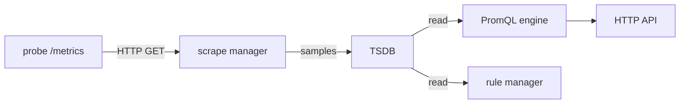

# The Scrape Pipeline: Server, Targets And Exporters

A graph in a dashboard looks like a simple thing, but it depends on a chain of separate steps. Software has to expose its numbers, something has to fetch them on a schedule, and something has to store them with a timestamp. This part follows that first half of the chain, from the exposed text to a stored sample, and names the Prometheus component that does each step. Knowing the components matters because every failure you debug later sits in exactly one of them.

## One scrape, from the target's side

A target is any HTTP endpoint that Prometheus scrapes. A scrape is one HTTP GET request that the Prometheus server sends to a target, usually to the path `/metrics`. The target answers with plain text in the Prometheus exposition format: one line per sample, with the metric name, optional labels in braces, and a number. Lines that start with `#` are comments. The special comments `# HELP` and `# TYPE` describe the metric.

The `probe` application in the playground answers like this. The numbers differ on every run, so they are shown here as placeholders:

```text
# HELP lab_requests_total Completed requests
# TYPE lab_requests_total counter
lab_requests_total{service="probe",status="200"} <number>
lab_requests_total{service="probe",status="500"} <number>
```

You can fetch the same text yourself. The `shuttle` pod runs in the same namespace and has the `wget` command, so it gives you a shell inside the cluster network:

<!-- astrona:playground:renew -->

```sh
kubectl -n starfleet exec shuttle -- wget -qO- http://probe:8080/metrics
```

The answer contains the two counters above, a gauge named `lab_queue_depth`, a gauge with the time of the last success, and a histogram named `lab_request_duration_seconds` with `_bucket`, `_sum` and `_count` lines. The application only reports its current totals. It does not know that Prometheus exists, and it does not send anything by itself. A counter in this text is a running total since the process started, not a count per scrape.

## The components of the Prometheus server

The Prometheus server is one process that contains several cooperating components. Reading the list once makes the rest of the module easier.

- The service discovery and scrape manager keeps the list of targets and sends the scrape requests on a schedule. The scrape manager runs one scrape loop for every target.
- The time series database (TSDB) stores the samples on local disk and answers requests to read them.
- The PromQL engine evaluates queries. PromQL is the Prometheus query language.
- The rule manager evaluates recording rules and alerting rules on a schedule.
- The web server offers the HTTP API, the built-in expression browser and the `/metrics` endpoint of Prometheus itself.
- The notifier sends firing alerts to Alertmanager. Alertmanager is a separate program that this module does not need yet.



The diagram shows that the scrape manager is the only component that writes samples from targets, while the query engine and the rule manager only read them. The rule manager writes too, but only the results of recording rules.

## Why Prometheus pulls

Prometheus uses a pull model: the server decides when to scrape, and the target only answers. This has three practical effects. First, the server knows which targets it expects, so a target that stops answering is noticed at once. Second, the server can scrape a target from any machine that can reach it, so a developer can start a second Prometheus on a laptop and scrape the same endpoint. Third, the scrape itself is a health check, because a failed request is recorded.

The `scrape_interval` setting controls how often the scrape loop runs for a target. The playground uses two seconds so that you see data quickly. A usual production value is 15 or 30 seconds. The server timestamps each sample with the time of the scrape, not with a time chosen by the application, unless the exposition text carries its own timestamp. Most applications do not add one.

## What the server adds: the up series

For every scrape Prometheus records extra series about the scrape itself. The most important one is `up`. It has the value 1 when the scrape succeeded and the value 0 when it failed. A scrape fails when the connection is refused, the request times out, the HTTP status is not 2xx, or the answer cannot be parsed. The server also attaches two labels to every sample from a target. The label `job` holds the name of the scrape job, and the label `instance` holds the address of the target, for example `probe:8080`.

Other automatic series describe the scrape: `scrape_duration_seconds` is how long it took, `scrape_samples_scraped` is how many samples the target returned, and `scrape_samples_post_metric_relabeling` is how many remain after relabeling. Ask Prometheus which targets it knows and whether their last scrape worked:

```sh
kubectl -n starfleet exec shuttle -- wget -qO- http://prometheus:9090/api/v1/targets
```

The JSON answer lists active targets with the fields `scrapeUrl`, `health`, `lastError` and `lastScrapeDuration`. The `probe` job and the `prometheus` job should both have `health` set to `up`. A target with `health` set to `down` has a text in `lastError` that names the reason, for example a refused connection.

Notice that `up` is a statement about the scrape, not about the application. If `probe` accepts the connection but returns a wrong answer for every real request, `up` stays 1 because `/metrics` still works. The application's own metrics must show that problem.

## Exporters

Many programs, such as a Linux kernel, a database or a hardware device, do not expose the Prometheus format. An exporter is a separate small program that reads the numbers from such a system and exposes them in the Prometheus format on its own `/metrics` endpoint. Prometheus then scrapes the exporter like any other target. The Node Exporter for host metrics is the best-known example. Some exporters run next to the program they watch, and some run elsewhere and query it over the network.

An exporter turns the question "how do I monitor this system" into the same scrape that every other target uses. The cost is one more process to run and to monitor. If the exporter stops, the metrics of the underlying system disappear, even though that system may be healthy. The `up` series of the exporter's target shows this case.

## A scrape that works and one that fails

Two different problems can hide behind an empty graph. If the target never answers, `up` is 0 and the series of the application are missing or stale. If the target answers but the metric name is wrong in your query, `up` is 1 and the query returns nothing. Check `up` first, then check the exact metric name in the target's text. The next part shows how to run those queries.

The route from the application to a stored sample is now clear: the scrape manager fetches the text, applies the target labels, and hands the samples to the TSDB. What happens inside the TSDB, and how a query finds the samples again, is the topic of the next part.

## Common pitfalls

> [!WARNING]
> - `up` equal to 1 only proves that the scrape worked. It does not prove that the application behaves correctly.
> - A counter in the exposition text is a running total. Use `rate` in a query to see change per second, never read the raw total as a speed.
> - Prometheus pulls. An application cannot make Prometheus store a value at a chosen moment by sending it; the value appears at the next scrape.
> - A refused connection, a timeout and a parse error all give `up` of 0. Read `lastError` in the targets API to tell them apart.
