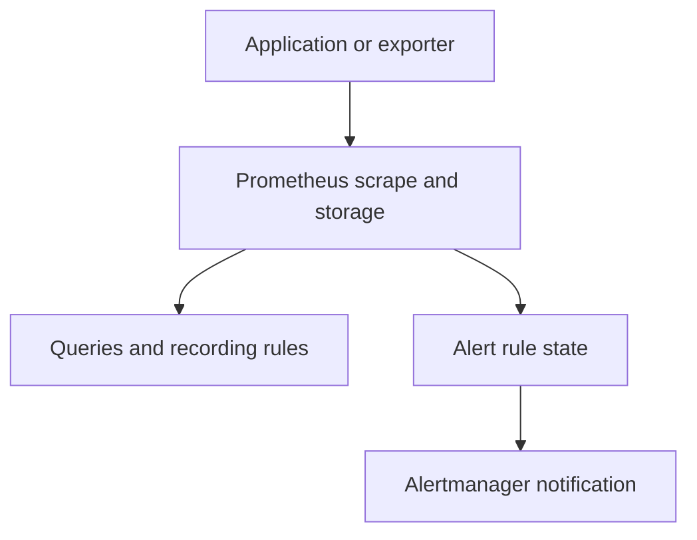

# The Prometheus Collection, Storage And Rule Pipeline

Prometheus is a collection and query system for labeled time-series metrics. Its normal pipeline starts with an instrumented application or exporter exposing values, continues through target discovery and scraping, and stores samples for queries and rules. Understanding the responsibilities at each stage prevents confusing a working endpoint with a functioning observability system.

## Exposition And Collection

The producer maintains metric state and exposes it in a supported format. Prometheus selects targets, sends scrape requests and processes their responses. The server adds target context such as job and instance labels according to configuration. A scrape is a snapshot of exposed metric state; it is not a request for the producer to send every individual business event.

Discovery and relabeling establish the effective endpoint and identity. Network reachability, authentication and response parsing determine whether collection succeeds. The generated up metric provides scrape health evidence, while application counters and gauges describe their own subject. A healthy scrape can coexist with severe business failures if the metrics endpoint remains available.

## Local Storage And Queries

The time-series database stores samples organized by metric identity and labels. Recent data uses memory and durable write-ahead mechanisms before becoming persisted blocks. Retention and storage capacity determine the available history. The query engine evaluates PromQL against that data, selecting series and applying functions or operators according to the expression.

A dashboard normally queries a data source rather than storing the authoritative metric history itself. Changing a panel's display does not change the samples already collected. Query cost depends on the selected series, time range and expression, so broad selectors over high-cardinality data can be expensive even if the graph displays only a few aggregated lines.

## Recording And Alerting Rules

A recording rule periodically evaluates an expression and stores the result under a named metric. This can make a commonly used derived calculation easier and less costly to query. Its labels and evaluation schedule become part of the derived series contract. It does not recover source samples that collection missed.

An alerting rule evaluates a condition and maintains alert state for its matching label sets. A configured duration can require the condition to persist before firing. Rule evaluation is therefore distinct from scraping, even when the processes run in the same server. Missing inputs, expression errors and evaluation delays can affect the result independently of target reachability.

## Notification Is Downstream

Prometheus sends alerts to Alertmanager, which groups, deduplicates and routes them to configured receivers. Silences and inhibition influence notification behavior. Alertmanager does not decide the original metric expression's truth or scrape the application's endpoint. A firing alert can exist while notification delivery fails, and a silence can suppress delivery without making the underlying condition healthy.

## Recognize Independent Failure Stages

Remote write can send collected samples to another receiving system. A destination outage can delay that delivery while local collection continues. A local storage problem can affect available history even when target requests succeed. An Alertmanager receiver error can interrupt notification while alert rules still fire.

For a missing dashboard line, first establish whether the producer exposed the metric, the target was selected and scraped, the sample was retained and the expression selected it. For a missing notification, follow rule state and routing separately. Each stage needs its own observation and correction.

## Pipeline Responsibilities

The branches have different outcomes: a query can succeed while a receiver fails, and an alert can remain firing while a notification is suppressed.

## Common pitfalls

> [!WARNING]
> Scraping, query evaluation, recording rules, alert state and notification delivery are separate responsibilities. Alertmanager does not collect application metrics, and a dashboard is not the authoritative storage pipeline.
