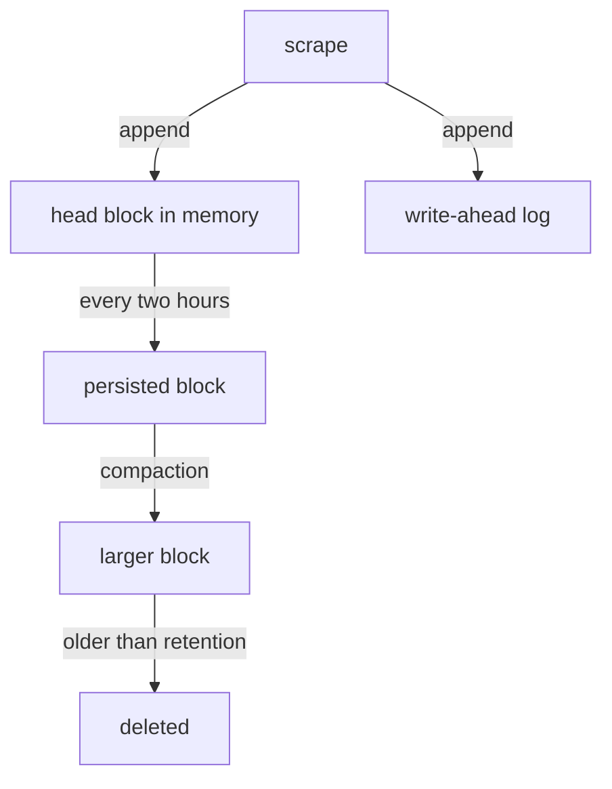

# Local Storage And Querying With PromQL

A scraped sample is useful only if it can be found again. Prometheus keeps samples on the local disk of the server in its own time series database, and it reads them back with a query language called PromQL. This part opens the storage to show why recent data is fast to read and why old data is cheap to keep. Then it follows a query from the HTTP API to the result, so you can read the JSON that every dashboard and every script receives.

## What a time series is

A time series is the list of samples of one metric with one exact set of label values, each sample having a timestamp and a floating point value. The two lines `lab_requests_total{status="200"}` and `lab_requests_total{status="500"}` are two different series, because their labels differ. The metric name is stored as the special label `__name__`. Each scrape adds one new sample to every series it returns.

Prometheus does not store events. It stores the value of each series at the scrape times. If the application handled 40 requests between two scrapes, Prometheus keeps two totals and the difference is computed later by a query.

## How the TSDB writes: head, write-ahead log and blocks

The time series database writes new samples into an in-memory structure called the head block. The head covers the most recent period, a few hours. Memory alone would lose data when the process stops, so every sample is also appended to the write-ahead log (WAL), a set of files in the `wal` directory. When Prometheus restarts, it replays the WAL to rebuild the head.

About every two hours the TSDB cuts the oldest part of the head into a persisted block. A block is a directory on disk that holds the samples of a time range, an index that maps label sets to series, and a metadata file. Blocks do not change after they are written. In the background the TSDB compacts small blocks into larger ones, which keeps the number of files low and the queries fast. The retention setting removes blocks that are older than the limit. The default retention time is 15 days.



The diagram shows two things: every sample takes two paths at first, and only blocks are ever deleted by retention.

In the playground the data directory is an `emptyDir` volume. A new Prometheus pod therefore starts with an empty database. That is why you must wait a short time after a restart before a one-minute `rate` returns a value: it needs at least two samples inside its window.

Prometheus exposes its own flags through the API. Check the retention and the storage path that this server uses:

<!-- astrona:playground:renew -->

```sh
kubectl -n starfleet exec shuttle -- wget -qO- http://prometheus:9090/api/v1/status/flags
```

Look for `storage.tsdb.path` and `storage.tsdb.retention.time` in the answer. If the retention flag shows an empty value, the default of 15 days applies.

## Selecting data with PromQL

PromQL is a read-only query language. A query is an expression that returns one of four types: an instant vector, a range vector, a scalar or a string. The two you use most are the first two.

An instant vector holds one sample per series, all taken at one point in time. The expression `lab_requests_total` is an instant vector selector. It returns the latest sample of every series with that metric name. You narrow it with label matchers in braces: `lab_requests_total{status="500"}` returns only the failed counter. The matchers are `=`, `!=`, `=~` for a regular expression and `!~` for a negated regular expression.

A range vector holds a list of samples per series over a time window. You write the window in square brackets, for example `lab_requests_total[1m]`. A range vector cannot be graphed directly. You pass it to a function such as `rate`, which turns the samples of the last minute into one number per series: the average increase per second. Functions that work on a range of one counter, like `rate` and `increase`, need at least two samples in the window.

The operator `sum by (job)` is an aggregation. It combines many series into fewer series and keeps only the labels you name. The expression `sum by (job) (rate(lab_requests_total[1m]))` first computes a per-second rate for each `status` series, then adds them together per `job`.

## The HTTP API

Everything a dashboard does goes through the HTTP API of the web server. Two endpoints run queries. The endpoint `/api/v1/query` evaluates an expression at one moment and returns an instant vector. The endpoint `/api/v1/query_range` evaluates it at many moments between a `start` and an `end`, separated by a `step`, and returns a matrix, which is a list of series with several samples each.

Run an instant query for the request rate. The query text goes in the `query` parameter and must be URL encoded. The simple expression `up` needs no encoding. The address is in quotes so that the shell does not change the `?`:

```sh
kubectl -n starfleet exec shuttle -- wget -qO- 'http://prometheus:9090/api/v1/query?query=up'
```

The answer is JSON. Its top level has the field `status`, set to `success` on a good query, and the field `data`. Inside `data`, `resultType` is `vector`, and `result` is a list. Each element has a `metric` object with the labels, including `__name__`, `job` and `instance`, and a `value` field holding two items: the evaluation timestamp and the sample value as a string. The `up` result must contain one element for the `probe` job and one for the `prometheus` job.

A bad expression returns `status` set to `error`, plus the fields `errorType` and `error` with the reason. Try an expression with a mistake to see this: a missing closing bracket gives a parse error with the position of the problem.

## Staleness, and what happens when a series disappears

A query at time T does not look at one exact timestamp. It uses the most recent sample that is not older than the lookback delta, which is five minutes by default. When a target disappears, or a series vanishes from a scrape, Prometheus writes a special stale marker into the series. After that marker the series no longer appears in instant queries. Without the marker a vanished series would still show its last value for five minutes.

This is why a query result can change in two ways: because the values changed, or because a series started or stopped existing. When you compare a result with an earlier one, compare the label sets as well as the numbers.

## Range queries and the step

A range query has one more setting than an instant query: the `step`. Prometheus evaluates the expression once at `start`, then at `start` plus one step, and so on until `end`. A step of 15 seconds over one hour gives 241 evaluation points per series. The step is only the spacing of the answers. It does not change the window inside the expression, so `rate(lab_requests_total[1m])` with a step of 15 seconds uses overlapping one-minute windows.

Grafana and the built-in expression browser pick the step for you from the width of the graph. If you run `query_range` yourself, choose a step that is not larger than the window of your `rate`, or you skip samples and the result looks smoother than the data.

## Query cost

The engine must load every sample of every selected series for the time window. A selector that matches ten series over one minute is cheap. A selector without matchers over a large range is expensive. The number of distinct label combinations of a metric is its cardinality. High cardinality is the main reason a server runs slowly or runs out of memory. Rules and dashboards that repeat the same expensive expression are the reason recording rules exist, and they are the topic of the next part.

You now know how a sample reaches the disk, how a query reads it back, and what the API returns. One question stays open: how can a calculation that every dashboard repeats be done once and stored? A recording rule answers it.

## Common pitfalls

> [!WARNING]
> - Passing a range vector such as `lab_requests_total[1m]` to a graph shows an error. Wrap it in `rate` or `increase` first.
> - `rate` on a freshly started server returns nothing until two samples exist inside the window.
> - Query strings must be URL encoded. A raw space or brace in a `wget` address can break the request.
> - Prometheus retention removes whole blocks. Setting a shorter retention does not free space until a block falls out of range.
> - The local database is a single copy on one disk. It is not a replicated store.
