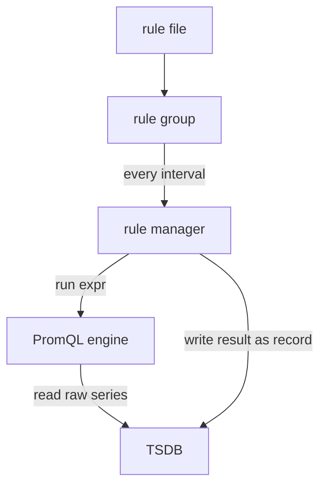

# Recording Rules And The Rule Manager

A query that is useful once is usually useful again. A dashboard runs the same expression every time someone opens it, and an alert runs it every evaluation. If the expression is expensive, the server repeats that cost many times. A recording rule moves the calculation into the server's schedule: Prometheus evaluates the expression once per interval and stores the result as a new time series. This part shows how the rule manager does that, how to name the result and how to make the server load a changed rule file.

## What a recording rule is

A recording rule is an entry in a rule file with two required fields. The field `record` holds the name of the new series. The field `expr` holds the PromQL expression. At every evaluation the rule manager runs the expression against the TSDB and writes each result element back into the TSDB as a sample of the series named in `record`. The labels of the result element become the labels of the new series. An optional `labels` map can add or overwrite labels.

Rules live in groups. A group has a `name`, an optional `interval` and a list of `rules`. The group is the unit of evaluation. Rules in one group run one after another, in order, all with the same evaluation timestamp. A rule can therefore use the result of an earlier rule in the same group. If you leave out `interval`, the group uses `evaluation_interval` from the global section of the configuration.



The diagram shows that the rule manager reads from the TSDB and writes back into the same TSDB, so a recorded series can be queried like any scraped series.

## Where the server finds rule files

The Prometheus configuration file has a list called `rule_files`. Each entry is a path or a glob pattern. In the playground the entry is `/rules/*.yaml`, and the directory `/rules` is a mounted ConfigMap named `prometheus-rules` with the key `rules.yaml`. At the start of the course the file holds only `groups: []`, an empty list. An empty list is valid, so the server runs with nothing to evaluate.

Check what the server has loaded. The rules API lists every group with its rules and the health of each:

<!-- astrona:playground:renew -->

```sh
kubectl -n starfleet exec shuttle -- wget -qO- http://prometheus:9090/api/v1/rules
```

While the file is empty, the `groups` list in the answer is empty. When a rule exists, the answer shows for each rule the fields `name`, `query`, `health`, `lastError`, `evaluationTime` and `type`. The type is `recording` or `alerting`. A healthy rule has `health` set to `ok`. A rule with `health` set to `err` carries the reason in `lastError`, for example an unknown function.

## Naming: level, metric and operations

A recorded series needs a name that tells the reader what it contains. The convention is `level:metric:operations`. The level lists the labels the series still has, the metric is the original metric name, and the operations list the functions applied, newest first. The rule `job:lab_queue_depth:max` says: the series is kept at the level of the `job` label, it comes from `lab_queue_depth`, and the operation is `max`. The colon is the only character in a metric name that instrumentation should never use, so a colon marks a name as a rule result.

When a rule divides one counter rate by another, remove the `_total` suffix from the name and put both operations after the metric. For example `job:lab_requests_errors:ratio_rate1m` is a ratio of two one-minute rates, kept per `job`. The convention does not change how Prometheus works. It makes the rule files readable and keeps the names unique.

## Writing and loading a rule

Take a gauge from the probe, `lab_queue_depth`. A rule that records its maximum per job needs one group with one rule. Rule files are YAML, and here the file is the ConfigMap that the server mounts, so the rule is written inside the key `rules.yaml`. Save this as `rules-queue.yaml`:

```yaml
apiVersion: v1
kind: ConfigMap
metadata:
  name: prometheus-rules
  namespace: starfleet
data:
  rules.yaml: |
    groups:
    - name: queue_summary
      interval: 5s
      rules:
      - record: job:lab_queue_depth:max
        expr: max by (job) (lab_queue_depth)
```

Apply it:

```sh
kubectl apply -f rules-queue.yaml
```

Applying the ConfigMap changes the object in the Kubernetes API. It does not change what the server evaluates. Kubernetes updates the mounted file inside the pod after a delay of up to about a minute, and Prometheus reads rule files only at start and on reload. Prometheus can reload when it receives the signal SIGHUP, or when it receives an HTTP POST to `/-/reload`, if it was started with the flag `--web.enable-lifecycle`. The simplest way that always works in the playground is to start a new pod, because a new pod reads the current ConfigMap:

```sh
kubectl -n starfleet rollout restart deployment/prometheus
kubectl -n starfleet rollout status deployment/prometheus
```

Then check the result. Ask the rules API again, and query the new series by its recorded name:

```sh
kubectl -n starfleet exec shuttle -- wget -qO- http://prometheus:9090/api/v1/rules
kubectl -n starfleet exec shuttle -- wget -qO- 'http://prometheus:9090/api/v1/query?query=job:lab_queue_depth:max'
```

The rule must have `health` set to `ok`, and the query result must contain a series with the label `job` and the name `job:lab_queue_depth:max`. If the query returns an empty result, wait one evaluation interval and try again. The first evaluation happens after the group starts, not at the moment you apply the file.

## Checking a rule file before loading it

A syntax error in a rule file stops a reload, and at start it stops the server. The tool `promtool` ships with Prometheus. The command `promtool check rules file.yml` parses the file without starting a server. It prints the number of rules found when the file is valid and exits with status 0. On an error it prints the reason to standard error and exits with status 1. Run it in a pipeline before the file reaches the server.

A related limit is worth knowing. A recording rule keeps the labels of its result, so a rule without an aggregation stores one new series for every input series and doubles the storage cost for that metric. Aggregate away the labels you do not need, as `max by (job)` does above.

## What a recording rule cannot do

A recording rule stores results from the moment it is loaded. It does not fill the past: the history of the new series begins at the first evaluation. It also cannot recreate samples that a scrape missed, because the rule reads the TSDB and the TSDB holds only what was scraped. If the group takes longer to evaluate than its interval, the next evaluation is skipped and the recorded series has a gap. The series `rule_group_iterations_missed_total` counts these skips.

You can now follow the whole chain: the application exposes text, the scrape manager stores samples, the PromQL engine reads them, and the rule manager stores derived results under a new name. The task on the next page asks you to build the two request recording rules yourself and to make the server load them.

## Common pitfalls

> [!WARNING]
> - `kubectl apply` on the ConfigMap does not make Prometheus read it. Reload or restart, then check `/api/v1/rules`.
> - A group with an expression error shows `health` of `err` for that rule only; read `lastError`.
> - Restarting Prometheus in the playground empties the database, so a new `rate` needs about a minute of data.
> - A ratio of two rates must use the same label aggregation on both sides, or the division matches no series.
> - A recording rule has no history. Panels that need old data must still use the raw series.
