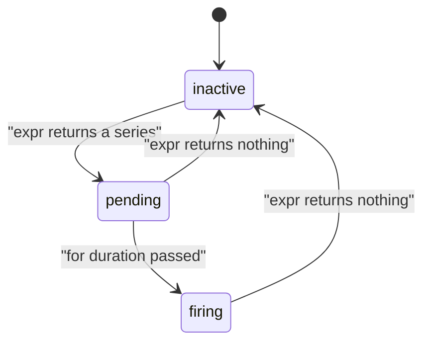

# Alerting Rules And Alert States

A graph can show that something is wrong, but nobody watches a graph all day. An alerting rule turns a condition into a state that other systems can act on. The Prometheus server evaluates the rule on a schedule, and when the condition holds long enough, the alert fires. This part shows what the rule manager does at each evaluation, the three states an alert moves through, and where the evaluation ends and notification begins.

## What an alerting rule is

An alerting rule is an entry in a rule file, in the same groups that hold recording rules. Its fields are:

- `alert`: the name of the alert, for example `LabHighErrorRatio`.
- `expr`: a PromQL expression. Every element the expression returns is one active alert, and its labels identify it.
- `for`: how long an element must stay active before the alert fires. It is optional.
- `keep_firing_for`: how long an alert keeps firing after its condition stopped being true. It is optional.
- `labels`: extra labels added to the alert, such as `severity: page`.
- `annotations`: descriptive text such as a summary, which can use templates.

The key idea is that the expression does not return true or false. It returns a set of series. A comparison such as `lab_queue_depth > 2` filters the series: it keeps those whose value is greater than 2 and returns nothing for the others. An empty result means no alert. A result with two series means two alerts, one for each label set.

## The three states

At every evaluation the rule manager runs the expression. For each label set in the result, the alert is in one of three states.

- Inactive: the expression returns nothing for that label set.
- Pending: the expression returns the label set, but the time since it first appeared is shorter than `for`.
- Firing: the expression has returned the label set during the whole `for` duration.

Without a `for` field, an alert becomes active on the first evaluation that returns the element, so it moves directly to firing. If the expression stops returning the element at any evaluation before the `for` time is over, the pending alert goes back to inactive and the timer starts again later. This protects against short spikes. If `keep_firing_for` is set, a firing alert stays firing for that time after the condition ends, which stops an alert from flapping between firing and resolved.



The diagram shows that only the pending state can be abandoned without a notification, and that a firing alert becomes resolved when its condition ends.

## A rule you can run

The gauge `lab_queue_depth` of the probe has the fixed value 3. A rule that fires when the queue is deeper than 2 therefore becomes active at once, and it lets you see all three states without waiting for failures. Save this as `rules-queue-alert.yaml`:

```yaml
apiVersion: v1
kind: ConfigMap
metadata:
  name: prometheus-rules
  namespace: starfleet
data:
  rules.yaml: |
    groups:
    - name: queue_alerts
      interval: 5s
      rules:
      - alert: QueueTooDeep
        expr: lab_queue_depth > 2
        for: 30s
        labels:
          severity: ticket
        annotations:
          summary: The probe queue holds more than two items
```

Apply it:

<!-- astrona:playground:renew -->

```sh
kubectl apply -f rules-queue-alert.yaml
```

Prometheus reads rule files at start and on reload. Restart the server so that the new pod reads the changed ConfigMap, and wait until it is ready:

```sh
kubectl -n starfleet rollout restart deployment/prometheus
kubectl -n starfleet rollout status deployment/prometheus
```

Ask the server for the alerts it holds. Run the command right after the server is ready, and again after about half a minute:

```sh
kubectl -n starfleet exec shuttle -- wget -qO- http://prometheus:9090/api/v1/alerts
```

If the first answer is an empty list, wait a few seconds for the first scrape and evaluation. Then the alert has the `state` value `pending`, and its `activeAt` field holds the time the condition first appeared. In the later answer, once 30 seconds have passed since `activeAt`, the `state` value is `firing`. The labels of the alert are the labels of the series that the expression returned, plus `alertname` and the labels from the rule. The annotations hold your summary.

## The ALERTS series

The server also stores its alert states as ordinary time series. The synthetic series `ALERTS` has one sample with the value 1 for every pending or firing alert. It carries the labels of the alert, the label `alertname` and the label `alertstate`, which has the value `pending` or `firing`. You can query and graph them:

```sh
kubectl -n starfleet exec shuttle -- wget -qO- 'http://prometheus:9090/api/v1/query?query=ALERTS'
```

Because `ALERTS` is a normal series, you can count the firing alerts with `count(ALERTS{alertstate="firing"})`, put them on a dashboard or use them in another rule. When the alert stops, the series goes stale like any other. The series records history that the `/api/v1/alerts` endpoint, which shows only the present, does not keep.

## Evaluation is not notification

The rule above fires even though no Alertmanager exists for it. The rule manager only decides the state. Sending a notification is a different job. When an alert is firing, the notifier component of Prometheus sends it over HTTP to every Alertmanager that is listed in the `alerting` section of the configuration file. It repeats the sending at regular intervals while the alert stays active, and it sends a resolved message when the alert ends. If the `alerting` section is empty, the alert is visible in Prometheus and goes nowhere.

The rules API shows the state of the evaluation itself. For each alerting rule the `health` field must be `ok`, and `lastEvaluation` must be recent. A rule whose expression refers to a metric that does not exist is still healthy. It returns an empty result forever and the alert stays inactive. This is the usual reason why an alert never fires: the rule is valid and evaluates well, but the expression selects nothing because of a wrong metric name or label.

## Writing good alert conditions

An alert should describe a symptom that a human must act on. A rule on the request error ratio is better than a rule on CPU use, because the first one describes what users feel. The `for` duration should be longer than the scrape and evaluation intervals, or the alert flaps. A `for` of 10 seconds with a scrape interval of two seconds, as in the lab of this module, is fine for a demonstration. Production rules use minutes.

Put a division in the expression with care. The expression `sum(rate(a{status="500"}[1m])) / sum(rate(a[1m])) > 0.05` has no labels left after `sum`, so the alert carries only the labels from the rule. This is often what you want, one alert for the whole service. If you wrote `sum by (instance)`, you would get one alert per instance.

You now know how an active alert is produced and how its state changes. The next question is what happens to a firing alert after it leaves Prometheus: who receives it, how it is grouped with others and how it can be silenced.

## Common pitfalls

> [!WARNING]
> - A rule with an unknown metric name is healthy and never fires. Run the expression as a query first and check that it returns a series.
> - A pending alert is not a firing alert. It sends nothing to Alertmanager until `for` has passed.
> - Changing the ConfigMap does not change the evaluated rules. Reload or restart Prometheus.
> - A `for` shorter than the evaluation interval cannot be measured. The alert becomes active in the first evaluation after the condition holds.
> - The alert shown in Prometheus and the alert shown in Alertmanager are two copies in two systems. Check both.
