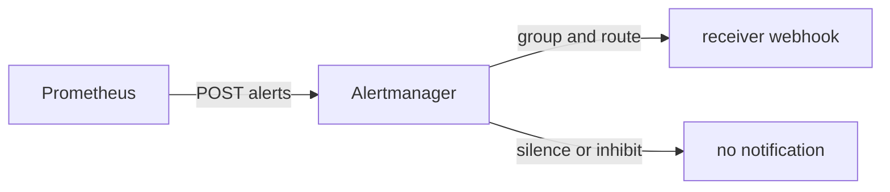

# Alertmanager: Grouping, Routing, Silences And Inhibition

When a database fails, fifty alerts can fire within a minute: one for each service that depends on it. If every one of them sends a message, the person on call gets fifty messages and reads none. Alertmanager is the separate program that solves this. It receives firing alerts from Prometheus servers and decides what to send, to whom and how often. This part explains its four main functions and the connection from Prometheus to it, because a rule that fires is useless if the connection or the routing is wrong.

## Where Alertmanager sits

Alertmanager is its own process with its own configuration file, its own HTTP API and its own state. It does not scrape targets and it does not evaluate expressions. It only receives alerts over HTTP, keeps them in memory for as long as they stay active, and sends notifications to receivers. A receiver is a named destination, such as an email address, a chat channel, a paging service or a generic webhook. In the playground the receiver is a webhook: Alertmanager sends an HTTP POST with a JSON body to the `probe` application, which stores what it receives.



The diagram shows that the decision to notify is made inside Alertmanager, after Prometheus has already decided the alert is firing.

## The connection from Prometheus

Prometheus learns where Alertmanager is from the `alerting` section of its configuration file. The section has a list named `alertmanagers`. Each entry describes a group of Alertmanager instances in the same way a scrape job describes targets, so it can use `static_configs` with `targets`, or a service discovery mechanism. A minimal entry looks like this:

```yaml
alerting:
  alertmanagers:
  - static_configs:
    - targets:
      - alertmanager:9093
```

Prometheus sends every alert to every Alertmanager in the list. It does not load balance between them. This matters for high availability. Alertmanager instances can form a cluster with the `--cluster-*` flags and share their silences and notification log with each other. Prometheus must still list every instance, so that alerts reach all of them. Then the cluster deduplicates the notifications.

The server shows what it knows about this connection. Run the command and look at the two lists in the answer:

<!-- astrona:playground:renew -->

```sh
kubectl -n starfleet exec shuttle -- wget -qO- http://prometheus:9090/api/v1/alertmanagers
```

The list `activeAlertmanagers` holds Alertmanagers that the server uses, with their `url`. The list `droppedAlertmanagers` holds addresses that relabeling removed. If both are empty, the server has no configured connection and no alert leaves it. If the `url` has the wrong port, the entry may still be listed, but the notifications fail, and the server logs errors about sending alerts.

## Grouping

Grouping combines alerts into one notification. The route has a `group_by` list of label names. All alerts that have the same values for those labels belong to one group, and Alertmanager sends them in one message. If `group_by` is `[alertname]`, all instances of one alert, for example `QueueTooDeep`, arrive together. If it is `[alertname, instance]`, each instance gets its own message.

Three timers control a group. The `group_wait` time is how long Alertmanager waits after the first alert of a new group, so that related alerts can join before the first notification. The default is 30 seconds. The `group_interval` time is how long it waits before it sends a notification about new alerts that joined an existing group. The default is five minutes. The `repeat_interval` time is how long it waits before it sends the same notification again, while the alerts stay firing. The default is four hours. The playground uses five and ten seconds for the first two, so you do not wait long.

## Routing

Routing selects the receiver. The configuration has one `route` at the top, which is the root of a tree. The root must have a receiver, and it catches every alert that no child route matches. A child route in `routes` has `matchers` that test the labels of an alert. A matcher such as `severity="page"` matches the alerts that carry that label. The first matching child route is used, and Alertmanager stops, unless the route sets `continue: true`, in which case the search goes on and the alert can go to more than one receiver. A child route inherits `group_by`, `group_wait` and the other settings from its parent unless it sets its own.

This is why the label `severity: page` in the alerting rule matters. The label is part of the alert as it is sent, and the routing tree reads it. A route for `severity="page"` sends to a paging service, and the default route sends the rest to a chat channel. A rule label and a route matcher that do not match send the alert to the default receiver. Nothing reports an error.

Look at the live configuration of the Alertmanager of the playground. Its API returns the running configuration in the status answer, and the list of receivers separately:

```sh
kubectl -n starfleet exec shuttle -- wget -qO- http://alertmanager:9093/api/v2/status
kubectl -n starfleet exec shuttle -- wget -qO- http://alertmanager:9093/api/v2/receivers
```

In the first answer find the route, with `group_by`, `group_wait` and `group_interval`, and the receiver `webhook` with its `url`. The second answer lists the receiver names.

## Silences

A silence mutes notifications for alerts whose labels match a set of matchers, between a start time and an end time. A silence is created by an operator through the web interface, the API or the `amtool` command. It does not touch Prometheus. The alert continues to fire there, and Alertmanager keeps it and shows it as suppressed, but it sends no notification. When the silence expires, notifications start again if the alert is still active. Silences are the right tool for planned work: you know a service will be down for maintenance.

Silences are stored in Alertmanager and shared in a cluster, not in a configuration file. A restart of a single Alertmanager without storage loses them. The `--storage.path` flag points at a directory where Alertmanager keeps its state between restarts. List the current silences, which are empty in a fresh playground:

```sh
kubectl -n starfleet exec shuttle -- wget -qO- http://alertmanager:9093/api/v2/silences
```

## Inhibition

Inhibition mutes notifications for some alerts while other alerts are firing. It is defined in the Alertmanager configuration in `inhibit_rules`. Each rule has `source_matchers`, `target_matchers` and a list `equal` of label names. If an alert that matches the source exists, and a target alert has the same values for the `equal` labels, the target alert is muted. A classic use: an alert `NodeDown` inhibits all `ServiceSlow` alerts from the same node, because the slowness is a consequence. Without the `equal` list the rule would mute targets everywhere.

Inhibition differs from a silence in two ways. It is automatic and driven by other alerts instead of time. It is also part of the configuration file, so it needs a configuration reload. The difference helps when you debug a missing notification: ask whether a silence matches, then whether an inhibit rule matches.

## Following one alert end to end

Alertmanager holds its own copy of each alert. When the Prometheus rule `QueueTooDeep` is firing and the connection exists, the list of alerts appears in the Alertmanager API:

```sh
kubectl -n starfleet exec shuttle -- wget -qO- http://alertmanager:9093/api/v2/alerts
```

If the list is empty although Prometheus shows a firing alert, the connection is the problem: check `/api/v1/alertmanagers` on Prometheus. If the list has the alert but the webhook receives nothing, the problem is inside Alertmanager: routing, a silence, an inhibit rule, or a receiver that cannot be reached. Each answer points at a different component, so ask the right system first.

The task that follows asks you to connect Prometheus to Alertmanager and write a paging rule, so that the whole chain from the error counter to the webhook works.

## Common pitfalls

> [!WARNING]
> - A firing alert in Prometheus does not prove that a notification was sent. Check the Alertmanager alerts and the receiver.
> - A wrong port in the `alerting` section keeps the connection broken even when the Alertmanager Service itself is healthy.
> - Routing matches on labels. A typo in a label name or value sends the alert to the default receiver, silently.
> - A silence hides the notification, not the alert. The alert stays in Prometheus and in Alertmanager.
> - Do not put a load balancer between Prometheus and a clustered Alertmanager. List every instance.
