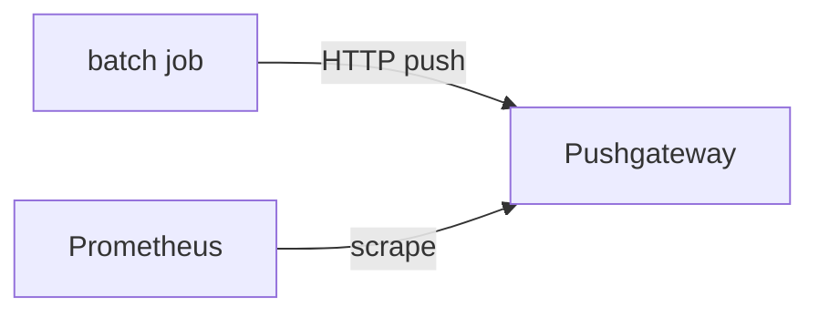

# Extending The Architecture: Pushgateway, Remote Storage, Federation And Discovery

A single Prometheus server that scrapes long-running targets covers many cases, and the architecture offers extra components for the cases it does not cover. Some jobs run for only a few seconds and cannot be scraped. Some teams need to keep data for years, or to see the metrics of several servers in one place. In a changing cluster, nobody can write the list of targets by hand. This part names each extension, what it does, how data flows through it and when it is the wrong tool.

## Pushgateway

The Pushgateway is a separate service that accepts metrics by HTTP push and then offers them to be scraped. It exists for batch jobs, which are processes that start, do work and exit. A scrape needs a process that is alive at the scrape time, and a batch job may finish within seconds. The job pushes its final metrics to the Pushgateway before it exits, and Prometheus scrapes the Pushgateway like any other target.

A job pushes with an HTTP request to a path that contains a grouping key, for example `/metrics/job/nightly_backup`. The body is the text exposition format. The Pushgateway keeps the last pushed values for each grouping key until someone deletes them. Prometheus then sees the same values on every scrape for as long as they are stored. For this reason the scrape job for a Pushgateway uses `honor_labels: true`, so that the `job` and `instance` labels of the pushed data are kept instead of being replaced by the labels of the Pushgateway target.



The diagram shows that Prometheus still pulls: it scrapes the Pushgateway, and only the job pushes.

The Pushgateway is not a general way to turn the pull model into push. It does not remove stale values, so a series from a job that stopped months ago stays and looks current. It also becomes a single point of failure, and `up` for the Pushgateway target says nothing about the individual jobs. Use it only for the output of service-level batch jobs. Use normal scrapes for everything that stays running.

A push body is the same text the scrape format uses. A job that backs up a database could send these lines to `/metrics/job/nightly_backup`:

```text
# TYPE backup_last_success_timestamp_seconds gauge
backup_last_success_timestamp_seconds <unix time>
# TYPE backup_duration_seconds gauge
backup_duration_seconds <seconds>
```

An alert can then compare `time() - backup_last_success_timestamp_seconds` with a limit. This is the pattern that the Pushgateway supports well: a timestamp of the last success, pushed once per run, checked by a rule.

## Remote write and remote read

Local storage is limited to one disk and the retention time. The remote write protocol lets Prometheus send the samples it scrapes to another system, for long-term storage or for a central query layer. You set it with a `remote_write` list in the configuration file. Each entry has a `url`, and it can have `write_relabel_configs` to choose which series to send. Prometheus reads from its write-ahead log and sends the samples in batches by HTTP, with a queue that retries on failure. If the receiver is down for longer than the WAL keeps data, samples are lost for the remote system, but not for the local database.

A `remote_read` entry works in the other direction. When a query needs data that is older than the local storage holds, Prometheus can ask the remote system for it, and then combines it with the local result. The remote system must speak the remote read protocol. Many systems that accept remote write also accept queries by PromQL themselves, so a dashboard can ask them directly. Prometheus can also receive remote write itself. You enable that with the flag `--web.enable-remote-write-receiver`, and then Prometheus accepts samples from other writers at `/api/v1/write`.

Remote write adds work to the server. It runs a queue for every destination, and the queue uses shards that send in parallel. When the receiver is slower than the scrape rate, the queue grows and the server uses more memory, until it falls behind. Prometheus exposes metrics with the prefix `prometheus_remote_storage_` for the queue length and for failed samples. Watch them, because a lagging remote write does not show up in the `up` series of any target.

You can look at the effective configuration of the playground server to see which of these sections exist. The configuration endpoint returns it as YAML in a JSON field:

<!-- astrona:playground:renew -->

```sh
kubectl -n starfleet exec shuttle -- wget -qO- http://prometheus:9090/api/v1/status/config
```

The playground has no `remote_write` and no `remote_read` entry, so its history lives only on the local disk. Notice also the `alerting` section, if one exists, and the `scrape_configs` list.

## Federation

Federation lets one Prometheus server scrape selected series from another Prometheus server. The source server exposes the endpoint `/federate`. The caller names the series with one or more `match[]` parameters, each holding an instant vector selector. The scraping server uses a normal scrape job with `metrics_path: /federate`, a `params` entry for `match[]`, and `honor_labels: true`, so the labels of the source stay unchanged.

Try the endpoint of the playground server. It returns the matching series in the text exposition format:

```sh
kubectl -n starfleet exec shuttle -- wget -qO- 'http://prometheus:9090/federate?match[]=up'
```

The answer has one line for each `up` series, with the labels `job` and `instance`. This is exactly what a second Prometheus would fetch.

There are two common federation layouts. In hierarchical federation, a global Prometheus scrapes aggregated series from many lower-level servers, one for each data center or cluster. In cross-service federation, one server pulls a few series of another team's server, so it can alert on them. Federation is meant for a small number of aggregated series. Copying all series of a large server through `/federate` is slow and fragile. For that, use remote write.

## Service discovery

Static lists of targets break in dynamic environments, where pods start and stop all the time. Service discovery (SD) lets Prometheus ask a platform for the targets. Prometheus has built-in mechanisms for Kubernetes, Consul, DNS, EC2, files and many others. A file-based mechanism, `file_sd_configs`, reads target lists from JSON or YAML files, so any tool can generate them. The discovery result for each target is a set of labels whose names begin with `__meta_`. Relabeling then turns them into the final labels and the address.

The Kubernetes mechanism has a `role` field that decides which objects become targets:

- `node`: one target per cluster node, using the kubelet address.
- `pod`: one target per container port of each pod. Pods that expose no ports still give one target without a port.
- `service`: one target per port of each Service. Useful for probing the Service itself.
- `endpoints`: one target for each address and port of the endpoints of a Service, with Service and pod metadata.
- `endpointslice`: the same as `endpoints`, built on the EndpointSlice API, which scales better.
- `ingress`: one target for each path of each Ingress, normally probed from outside.

The configuration of this playground uses `static_configs` with the fixed address `probe:8080`. A Kubernetes setup would replace it with `kubernetes_sd_configs` and `role: pod` or `role: endpoints`, plus relabel rules that keep only pods with an annotation. The list of discovered targets is the same API you used before, `/api/v1/targets`. It shows `discoveredLabels` before relabeling and `labels` after.

## Choosing the right extension

Each extension solves one problem. Short-lived batch jobs need the Pushgateway. Long-term storage and a global view need remote write. A small set of aggregated series from another server fits federation. A changing set of targets needs service discovery. Mixing them up causes the typical failures: a Pushgateway full of dead jobs, a federation endpoint that times out, or a remote write queue that falls behind.

## Common pitfalls

> [!WARNING]
> - The Pushgateway keeps pushed values until they are deleted. A stopped job still looks alive.
> - Scrape the Pushgateway and a federation endpoint with `honor_labels: true`. Without it the source labels are overwritten.
> - Remote write copies samples. It does not make the local database durable or highly available.
> - Federating every series of a large server overloads both servers. Select aggregated series with `match[]`.
> - Choose the Kubernetes SD role by what a target must be. A `pod` role gives pod targets, while the `service` role gives Service targets, and they are not interchangeable.
