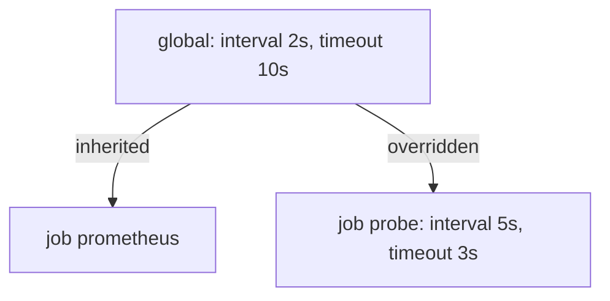

# Global Defaults And Scrape Jobs

A Prometheus server does nothing by itself until a configuration file tells it what to collect. This part reads that file from the top. You will see the two sections that matter most, `global` and `scrape_configs`, and the timing settings that decide how often and for how long Prometheus talks to a target. The goal is that you can look at any `prometheus.yml` and predict the exact HTTP request that the server sends.

## The file the playground uses

The server in the playground reads the key `prometheus.yaml` of the ConfigMap `prometheus-config`. The key is mounted as a file and passed to the server with the flag `--config.file`. The content is short:

```yaml
global:
  evaluation_interval: 2s
  scrape_interval: 2s
rule_files:
- /rules/*.yaml
scrape_configs:
- job_name: probe
  static_configs:
  - labels:
      team: starfleet
    targets:
    - probe:8080
- job_name: prometheus
  static_configs:
  - targets:
    - localhost:9090
```

The file has three top-level keys. `global` holds default values for all jobs. `rule_files` lists patterns of files with recording rules and alerting rules. `scrape_configs` is a list of scrape jobs, and each job describes one group of targets that are scraped in the same way. A target is one HTTP endpoint that Prometheus scrapes, and a scrape is one HTTP GET request to it.

You can read the configuration that the running server actually uses from its HTTP API. The answer is the file, normalized and with every default filled in:

<!-- astrona:playground:renew -->

```sh
kubectl -n starfleet exec shuttle -- wget -qO- http://prometheus:9090/api/v1/status/config
```

The reply is JSON with one field, `yaml`, that contains the whole configuration as one string. Look at the `probe` job in it. Fields that you did not write, such as `metrics_path`, `scheme`, `scrape_timeout` and `follow_redirects`, now appear with their default values. This shows that the file you write is only a part of the configuration that is in force.

## The global section

The `global` section sets defaults. Three keys matter here.

- `scrape_interval` is the time between two scrapes of the same target. The default is one minute. The playground sets two seconds so that data appears quickly.
- `scrape_timeout` is how long Prometheus waits for the answer to one scrape before it gives up and counts the scrape as failed. The default is ten seconds.
- `evaluation_interval` is how often the rule manager evaluates recording rules and alerting rules. The default is one minute. It is independent of scraping: a rule group can be evaluated more or less often than data arrives.

A fourth group of keys, `external_labels`, attaches labels to data that leaves the server, such as alerts and remote write. It does not change the stored series.

The three timing values are separate clocks. Changing `evaluation_interval` never changes how often targets are scraped, and changing `scrape_interval` never changes how often rules run. A rule that uses `rate()` over a short window still needs at least two samples inside the window, so the scrape interval limits how short that window can be.

## Per-job overrides

Every scrape job can set its own `scrape_interval` and `scrape_timeout`. A value in the job overrides the global value for that job only. A job that does not set a value inherits the global one. For example, a job for a slow exporter can use a 30 second interval and a 20 second timeout while the other jobs keep the global value.

There is one validity rule. `scrape_timeout` cannot be greater than `scrape_interval`. If it is, Prometheus refuses the file. The rule is checked after inheritance, so a job that only sets `scrape_interval: 1s` under a global timeout of 10 seconds is also invalid, because the inherited timeout is larger than the new interval. Remember to set both values together when you shorten an interval.



The diagram shows that the job `prometheus` uses the global values, while the job `probe` replaces them with its own values.

## How the scrape URL is built

A scrape job does not contain a URL. Prometheus builds the URL from three parts: the scheme, the address of the target and the metrics path. The scheme is `http` unless the job sets `scheme: https`. The address is the `host:port` text from `targets`. The path is `/metrics` unless the job sets `metrics_path`. For the job `probe` the result is `http://probe:8080/metrics`.

This explains two frequent mistakes. A wrong port in `targets` gives a connection error, because nothing listens there. A wrong `metrics_path` gives an HTTP 404 answer, because the application listens but has no such path. Both make the target unhealthy, but the error text is different, and the text tells you which setting to fix.

The targets API shows the final URL and the last error of every target:

```sh
kubectl -n starfleet exec shuttle -- wget -qO- 'http://prometheus:9090/api/v1/targets?state=active'
```

Find the `probe` target in the reply. Its `scrapeUrl` is the URL built from the three parts, `health` is `up`, `lastError` is empty, and `scrapeInterval` and `scrapeTimeout` show the values that apply to this target. The same fields exist for a failed scrape, with `health` set to `down` and a non-empty `lastError`.

## Change the timing of one job

Now you override the timing for `probe` and leave the other job alone. Save this as `prometheus-config.yaml`:

```yaml
apiVersion: v1
kind: ConfigMap
metadata:
  name: prometheus-config
  namespace: starfleet
data:
  prometheus.yaml: |
    global:
      evaluation_interval: 2s
      scrape_interval: 2s
    rule_files:
    - /rules/*.yaml
    scrape_configs:
    - job_name: probe
      scrape_interval: 5s
      scrape_timeout: 3s
      static_configs:
      - labels:
          team: starfleet
        targets:
        - probe:8080
    - job_name: prometheus
      static_configs:
      - targets:
        - localhost:9090
```

Apply it:

```sh
kubectl apply -f prometheus-config.yaml
```

The ConfigMap now holds the new file, but the running server still uses the old one. The server reads the file at start and on a reload request, so restart the deployment, which starts a new pod with the new file:

```sh
kubectl -n starfleet rollout restart deployment/prometheus
kubectl -n starfleet rollout status deployment/prometheus
```

Then check the result with the targets API again. The target `probe` now reports `scrapeInterval` of 5s and `scrapeTimeout` of 3s, and the target `prometheus` still reports 2s. This confirms that a job value changes only its own job.

## Summary of the part

You can now read the three top-level keys of the file, explain the three timing clocks, and rebuild the scrape URL from scheme, address and path. You also know that a job value overrides a global value and that the timeout must not exceed the interval. What you cannot yet explain is why every series from this job carries the labels `job` and `instance`, and where the extra label `team` comes from. That is the next question.

## Common pitfalls

> [!WARNING]
> - Setting a short `scrape_interval` in a job without a matching `scrape_timeout`. The inherited global timeout can be larger than the new interval, and Prometheus then rejects the file.
> - Putting per-job timing into the `global` section. A global value changes every job, including the job that scrapes Prometheus itself.
> - Confusing `evaluation_interval` with `scrape_interval`. The first controls rules, the second controls collection.
> - Fixing a 404 error by changing the port, or a connection error by changing the path. Read `lastError` first: it names the failing step.
> - Writing a path without a leading slash in `metrics_path`. The path must start with `/`.
