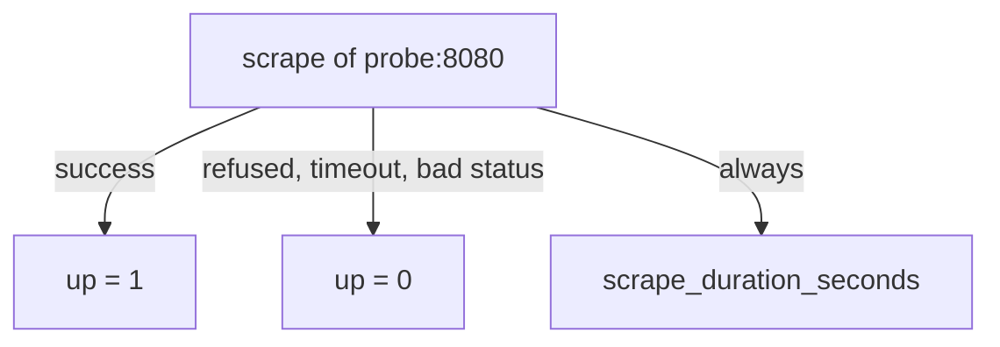

# Job And Instance Labels, The up Series And Scrape Health

Once a scrape works, every sample from the target needs an identity. Without one, the samples of two servers running the same application would be stored as the same series. This part explains how Prometheus labels each sample with the job and the instance, how you add your own labels to a target group, and which automatic series tell you whether a scrape worked. These series are the first thing to read when a dashboard looks wrong.

## Labels that Prometheus attaches

A label is a key and value pair that is part of the identity of a series. Prometheus attaches two labels to every sample that it scrapes. The label `job` holds the `job_name` of the scrape job. The label `instance` holds the `host:port` address of the target.

For the job `probe` with the target `probe:8080`, a scraped counter is stored with the labels `job="probe"` and `instance="probe:8080"`. The application itself only wrote `lab_requests_total{service="probe",status="200"}`. The scrape manager added the other two labels when it stored the sample. You can see them with a query:

<!-- astrona:playground:renew -->

```sh
kubectl -n starfleet exec shuttle -- wget -qO- 'http://prometheus:9090/api/v1/query?query=lab_requests_total'
```

The reply lists one series per `status` value. Each entry in `metric` has `__name__`, `instance`, `job`, `service`, `status` and also `team`. The label `team` is not in the application output either. It comes from the target group in the configuration, which is the subject of the next section.

The instance label defaults to the address because Prometheus copies the internal label `__address__` into `instance` when no rule has set `instance` earlier. Because the default is the address, two targets of one job always have different instance values, and the pair of `job` and `instance` identifies one target.

## Labels on a target group

A `static_configs` entry is a target group. It has a `targets` list and an optional `labels` map. Every label in the map is attached to all targets of that group, and from there to every series scraped from them:

```yaml
static_configs:
- labels:
    team: starfleet
  targets:
  - probe:8080
```

A job can have several target groups, each with its own labels. This is the simplest way to mark where a target runs, for example the environment, the team or the region. The label is set before the scrape, so it is part of the target, and it ends up on every series of the target, including the automatic series described below.

Setting a label in the group is different from adding a label in the application code. A label from the group is the same for all series of that target and costs nothing in the application. A label in the application can differ per series, but the application must be changed to add it.

## The label conflict

Sometimes the scraped text already carries a label with the name of a target label. An exporter may expose `job="batch"` on a series, or an application may expose its own `instance`. The same name then exists twice: once from the target and once from the scraped sample.

By default, `honor_labels` is false, and Prometheus keeps the labels of the target. It renames the scraped label by adding the prefix `exported_`. The series then has `job="probe"` from the target and `exported_job="batch"` from the sample. If `honor_labels` is true, the scraped value wins and the target label is dropped. Use true only for sources that are meant to carry the true identity of the data, such as a Pushgateway. For an ordinary application, a true value lets the application hide which target the data came from.

## The up series and the scrape series

For every target, Prometheus records automatic series about the scrape itself. They carry the same `job` and `instance` labels as the target.

- `up` is 1 when the scrape succeeded and 0 when it failed.
- `scrape_duration_seconds` is the time that the scrape took.
- `scrape_samples_scraped` is the number of samples that the target returned.
- `scrape_samples_post_metric_relabeling` is the number of samples that remained after `metric_relabel_configs` ran.
- `scrape_series_added` is the number of new series in this scrape.

Query `up` and `scrape_duration_seconds` for the `probe` job:

```sh
kubectl -n starfleet exec shuttle -- wget -qO- 'http://prometheus:9090/api/v1/query?query=up%7Bjob%3D%22probe%22%7D'
```

The expression in the URL is `up{job="probe"}` with the special characters encoded. The result has one series with the value 1 while the target answers. The value in the result is a pair of a Unix timestamp and a string, because the HTTP API returns sample values as strings.



The diagram shows that `up` records the outcome of each scrape, while the duration series exists whether or not the scrape succeeded.

## Reading a failed scrape

A scrape fails for one of four reasons: the connection is refused or cannot be made, the request exceeds `scrape_timeout`, the answer has an HTTP status outside the 2xx range, or the body cannot be parsed as metrics. In every case `up` becomes 0 and the targets API shows the reason in `lastError`.

The important point is that `up` of 0 says only that Prometheus could not collect data from the endpoint. It does not say that the application is down. The application may run well while the path is wrong, the port is wrong, a network policy blocks the request or the answer is too slow for the timeout. Equally, `up` of 1 says that the metrics endpoint answers, not that the application works.

You can see the failure mode that a wrong configuration produces without breaking the playground. Query the scrape duration in relation to the timeout. A target whose duration approaches the timeout will soon fail:

```sh
kubectl -n starfleet exec shuttle -- wget -qO- 'http://prometheus:9090/api/v1/query?query=scrape_duration_seconds%7Bjob%3D%22probe%22%7D'
```

The value is a small number of seconds that you read from your own run. Compare it with the 10 second default timeout, or with the timeout that you set for the job.

When `up` is 0, the debugging order is short. Read `lastError` in the targets API. If it says connection refused, check the port and the Service. If it names a status code, check the path. If it names a timeout, compare the duration with `scrape_timeout`. If it names a parse error, fetch the endpoint with `wget` and read the text.

## Summary of the part

You know that `job` and `instance` come from the configuration and the address, that labels on a target group reach every series of the targets, and that a conflict with a scraped label is solved by `exported_` unless `honor_labels` is true. You can read `up` and the `scrape_*` series, and you know that `up` measures the scrape, not the application. The open question is how a changed file gets into a running server and how to check a file before it breaks the server.

## Common pitfalls

> [!WARNING]
> - Reading `up` of 0 as proof that the application is down. It means that the scrape failed, and the cause can be the path, the port, the network or the timeout.
> - Setting `honor_labels: true` on an ordinary application. The application can then overwrite `job` and `instance` and hide the real source.
> - Adding a label to the target group and expecting old samples to change. The label exists only on samples scraped after the new configuration loaded.
> - Querying `up` without a `job` matcher and reading the result of another job.
> - Forgetting that the HTTP API returns sample values as strings inside a pair with a timestamp.
