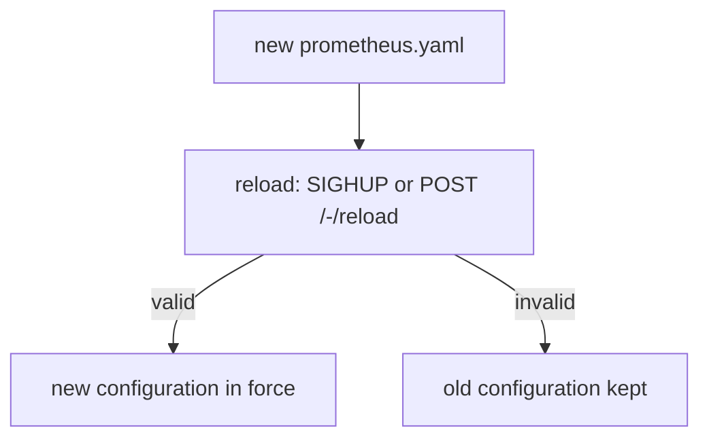

# Validating And Reloading The Configuration

A configuration change is only useful when the running server uses it, and it must not break the server on the way. Prometheus reads the file at start and again when it receives a reload request. If the new file is invalid, a safe server keeps the old configuration and reports the error. This part explains the checking tool `promtool`, the two ways to trigger a reload and the metrics that prove that a reload worked.

## Check the file before you load it

`promtool` is a command-line tool that ships next to the Prometheus server. The command `promtool check config` reads a configuration file, parses it, and also loads the rule files that it names. It exits with status 0 when the file is valid and with a non-zero status when it is not. It prints the checked files and a result line for each of them.

The Prometheus container image contains `promtool`. The file is mounted at `/config/prometheus.yaml` in the pod, so you can check the file that is currently mounted:

<!-- astrona:playground:renew -->

```sh
kubectl -n starfleet exec deploy/prometheus -- promtool check config /config/prometheus.yaml
```

For a valid file, the command reports that the file is successful and lists the rule files that it found. The exact lines depend on the version, so read them in your terminal and check that the final status of the file is a success. Rule files that match `/rules/*.yaml` are checked too.

The check finds syntax errors, unknown keys, a `scrape_timeout` that is greater than `scrape_interval`, and a regular expression that does not compile. It does not know whether a target exists, so a wrong port still passes. It checks the shape of the file, not the network.

## Make the check fail on purpose

A check that never fails teaches little. Save this file as `bad-prometheus.yaml` in your working directory. It has a timeout that is longer than the interval:

```yaml
global:
  scrape_interval: 2s
scrape_configs:
- job_name: probe
  scrape_timeout: 5s
  static_configs:
  - targets:
    - probe:8080
```

The playground pod does not have this file, and `promtool` runs inside the pod. Copy the file into the pod, then check it:

```sh
kubectl -n starfleet cp bad-prometheus.yaml deploy/prometheus:/tmp/bad-prometheus.yaml
kubectl -n starfleet exec deploy/prometheus -- promtool check config /tmp/bad-prometheus.yaml
```

The command prints a failure for this file and exits with a non-zero status. The message names the scrape timeout and the interval. Read it in your terminal: the text identifies the job and the rule that failed, which is the same information that the server would write to its log if you loaded the file. Note that `kubectl cp` needs the `tar` program inside the container, so if the copy fails in your image, skip this step and keep the principle: check first, load second.

## Two ways to reload

Prometheus does not watch its configuration file. A reload happens only when something asks for it. There are two supported requests.

The first is the signal SIGHUP, a Unix signal that the operating system delivers to the process. When the Prometheus process receives SIGHUP, it reads the file again. On a host, the command is `kill -HUP <pid>`. In Kubernetes, you need a shell in the container to send it, which is awkward.

The second is an HTTP request. When the server starts with the flag `--web.enable-lifecycle`, the endpoint `/-/reload` accepts a POST request and triggers the same reload. The playground server has this flag. The request needs the POST method, so a plain browser address does not work.

Both ways do the same work. The server parses the new file, and if it is valid, it applies the new scrape jobs and reloads the rule files. If the file is not valid, the server rejects it and keeps running with the previous configuration. The request returns an error and the reason goes to the server log.



The diagram shows that a failed reload leaves the server on the previous configuration, which is why the metric below matters.

## Reload in the playground

There is a delay you must know about. When you change a ConfigMap, Kubernetes updates the mounted file in the pod only after some time, often up to a minute. A reload request sent right after `kubectl apply` can therefore read the old file. The restart of the deployment avoids the delay, because a new pod mounts the current ConfigMap:

```sh
kubectl -n starfleet rollout restart deployment/prometheus
kubectl -n starfleet rollout status deployment/prometheus
```

A restart also clears the in-memory state of the head block and starts a new pod. Because the playground stores data on an `emptyDir` volume, the stored samples are lost with the old pod. That is acceptable here but not in production, where a reload keeps the process and its data.

When the mounted file is current, you can reload without a restart. The `wget` of the `shuttle` pod can send a POST request with an empty body:

```sh
kubectl -n starfleet exec shuttle -- wget -qO- --post-data='' http://prometheus:9090/-/reload
```

The server answers with an empty body when the reload worked. If the new file is invalid, the answer is an error that names the problem. Use this request after you have waited for the mounted file to update, or after you have checked the file in the pod with `promtool`.

## Prove that the reload worked

Do not trust that a request worked. Prometheus exposes two metrics about itself that show the result of the last reload:

- `prometheus_config_last_reload_successful` is 1 when the last reload worked and 0 when it failed.
- `prometheus_config_last_reload_success_timestamp_seconds` is the Unix time of the last successful reload.

Query the first one:

```sh
kubectl -n starfleet exec shuttle -- wget -qO- 'http://prometheus:9090/api/v1/query?query=prometheus_config_last_reload_successful'
```

A value of 1 means that the configuration in force is the last one that the server read. A value of 0 means that the server still runs an older configuration, and an alert on this metric is the standard way to find a broken change early. Then confirm the content with `/api/v1/status/config`, which returns the configuration in force. Comparing it with your file shows whether your change is active.

## Summary of the part

You can check a file with `promtool check config` before you load it, and you know what the check covers and what it cannot know. You know that Prometheus reloads only on SIGHUP or on a POST to `/-/reload` when `--web.enable-lifecycle` is set, that an invalid file leaves the old configuration in force, and that `prometheus_config_last_reload_successful` shows the result. You also know the ConfigMap delay in Kubernetes and why the playground restarts the deployment.

## Common pitfalls

> [!WARNING]
> - Sending a reload right after `kubectl apply` and reading the old file because the ConfigMap volume has not updated yet.
> - Using a GET request on `/-/reload`. The endpoint needs POST, and it exists only with `--web.enable-lifecycle`.
> - Assuming that a passing `promtool check config` means that every target works. It checks the file, not the network.
> - Not looking at `prometheus_config_last_reload_successful` and believing that a failed reload applied.
> - Restarting a production server to load a change, which drops its in-memory state, when a reload would do.
