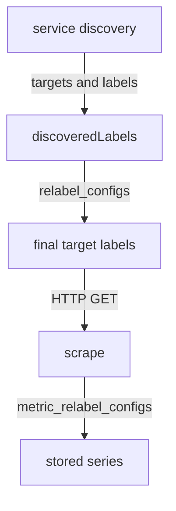

# Service Discovery And Target Labels

A scrape job needs a list of targets. Writing every address by hand works for three servers and fails for three hundred, because the list changes while the system runs. Prometheus therefore separates two tasks: finding targets and describing how to scrape them. This part explains the discovery methods that need no external system, and the labels that every discovered target carries before any rewriting happens.

## Static targets

Service discovery is the mechanism that produces the list of targets for a job. The simplest mechanism is `static_configs`, where the targets are written in the configuration file. The playground configuration uses it:

```yaml
scrape_configs:
- job_name: probe
  static_configs:
  - labels:
      team: starfleet
    targets:
    - probe:8080
```

This is a good fit when the set of targets is small and stable, or when a stable DNS name or Kubernetes Service name already hides the changing addresses behind it. The playground does exactly this: `probe` is the name of a Kubernetes Service, and the cluster DNS resolves it. The disadvantage is that every change of the list is a change of the file and a reload.

## File-based discovery

`file_sd_configs` moves the list out of the main file. The job names one or more files, and Prometheus reads the target groups from them. A file is YAML or JSON and holds a list of target groups. Each group has a `targets` list and an optional `labels` map, the same shape as a `static_configs` entry.

A job that reads its targets from files looks like this:

```yaml
scrape_configs:
- job_name: probe-files
  file_sd_configs:
  - files:
    - /targets/*.yaml
    refresh_interval: 1m
```

A file in `/targets` could contain:

```yaml
- targets:
  - probe:8080
  labels:
    env: lab
```

The server watches the files and applies a change when a file changes. It also re-reads them at `refresh_interval`, which is five minutes by default, as a fallback. A change that produces a well-formed list of groups is applied, and a malformed file is ignored, so the previous targets stay. No reload of the main configuration is needed. This is why file-based discovery is the usual bridge to other tools: a script, a configuration management system or an orchestrator writes the files, and Prometheus follows them.

Other mechanisms follow the same idea with a different source. Kubernetes discovery (`kubernetes_sd_configs`) asks the Kubernetes API for pods, Services, endpoints, nodes or ingresses. DNS discovery (`dns_sd_configs`) resolves DNS records. Cloud and registry mechanisms exist too. All of them end the same way: a list of targets, each with a set of labels.

## What a discovered target looks like

Before any rule runs, each target has an initial label set. The set depends on the mechanism, but some labels are always there.

- `__address__` is the `host:port` text of the target.
- `__scheme__` is the scheme, `http` unless the job sets `scheme`.
- `__metrics_path__` is the path, `/metrics` unless the job sets `metrics_path`.
- `__scrape_interval__` and `__scrape_timeout__` are the interval and timeout of the job.
- `job` is the job name.
- `__param_<name>` exists for every URL parameter that the job sets in `params`.
- Labels from the `labels` map of the target group.
- Meta labels of the form `__meta_<mechanism>_<detail>`. Each mechanism defines its own. Kubernetes discovery gives labels such as the pod name, the namespace and the pod labels. File discovery gives the path of the file as `__meta_filepath`.

Labels that start with two underscores are internal. Prometheus removes them from the label set after relabeling is done, so they never reach the stored series. A meta label is useful only if a rule copies it into a normal label before that happens.

## Look at the labels in the playground

Prometheus keeps both views of every target: the labels before relabeling and the labels after. The targets API returns both. The field `discoveredLabels` holds the set before relabeling, and `labels` holds the final set:

<!-- astrona:playground:renew -->

```sh
kubectl -n starfleet exec shuttle -- wget -qO- 'http://prometheus:9090/api/v1/targets?state=active'
```

Find the target of the job `probe`. In `discoveredLabels` you see `__address__` with the value `probe:8080`, the `__metrics_path__` and `__scheme__` values, the interval and timeout values, `job` and `team`. In `labels` you see `instance` with the value `probe:8080`, `job` and `team`, and no double underscore labels. The label `instance` appeared because Prometheus copies `__address__` to `instance` when no rule sets it.

The same API is also available as a page in the Prometheus web interface, under the status menu, as the targets and service discovery pages. The service discovery page shows the labels before and after relabeling side by side. It is the quickest way to debug a rule, because it shows the input that the rule received.



The diagram shows the order of the stages: discovery produces labels, `relabel_configs` turns them into the final target, the scrape runs, and `metric_relabel_configs` filters the samples before storage.

## Two jobs for one application

A job that reads files has no `static_configs`. Its targets come from the files that match the pattern. If a file holds a target group with `probe:8080`, Prometheus scrapes the same application a second time under another job name. The job name differs, so the series differ, and the labels `job` and `instance` tell the two copies apart. This also shows why a job name must be unique: the job name is part of the identity of every series that the job produces.

The playground does not mount a target directory, so the file-based job above is a form to read and recognize. The next part changes the playground configuration with static targets, where every result can be observed.

## Summary of the part

You know that service discovery produces targets and labels, that `static_configs` and `file_sd_configs` need no external system, and that file discovery lets another tool change the targets without a reload. You can name the internal labels of a target and tell `discoveredLabels` from the final `labels` in the targets API. The open question is how to change the final labels and which targets are kept, and that is the work of relabeling.

## Common pitfalls

> [!WARNING]
> - Writing a file for `file_sd_configs` as a single object. The file must hold a list of target groups.
> - Expecting a meta label on the stored series. Labels that start with two underscores are removed after relabeling, so a rule must copy them first.
> - Waiting for a file change that Prometheus ignored. A malformed file is not applied, and the previous targets stay.
> - Editing a file inside a ConfigMap and expecting an instant effect. The mounted file updates with a delay.
> - Reading `instance` as the name of a host. It is the address that the target had, unless a rule changed it.
