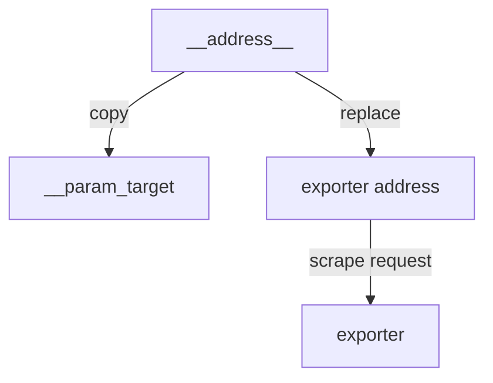

# Relabeling Targets Before The Scrape

Discovery gives you targets with labels that someone else chose. The address may be a pod IP, the instance label may be useless in a dashboard, and some targets should not be scraped at all. Relabeling is the tool that fixes this, and it runs before Prometheus sends the scrape request. This part explains how a relabeling rule works, the main actions, and how the internal labels control the scrape itself.

## Start from a result

The playground job `probe` has the target `probe:8080`, so its series have `instance="probe:8080"` and no `tier` label. The goal is to make the instance a fixed readable name and to add the label `tier` with the value `backend`. Both changes belong to the target, so they go into `relabel_configs`, the list of rules that Prometheus applies to the label set of each target before it scrapes.

<!-- astrona:playground:renew -->

Save this as `prometheus-config.yaml`:

```yaml
apiVersion: v1
kind: ConfigMap
metadata:
  name: prometheus-config
  namespace: starfleet
data:
  prometheus.yaml: |
    global:
      evaluation_interval: 2s
      scrape_interval: 2s
    rule_files:
    - /rules/*.yaml
    scrape_configs:
    - job_name: probe
      static_configs:
      - labels:
          team: starfleet
        targets:
        - probe:8080
      relabel_configs:
      - target_label: tier
        replacement: backend
      - target_label: instance
        replacement: probe-main
    - job_name: prometheus
      static_configs:
      - targets:
        - localhost:9090
```

Apply it and load it:

```sh
kubectl apply -f prometheus-config.yaml
kubectl -n starfleet rollout restart deployment/prometheus
kubectl -n starfleet rollout status deployment/prometheus
```

Then check the result. After a few seconds, the targets API shows the final labels:

```sh
kubectl -n starfleet exec shuttle -- wget -qO- 'http://prometheus:9090/api/v1/targets?state=active'
```

For the `probe` target, `labels` now has `instance` set to `probe-main` and `tier` set to `backend`, while `scrapeUrl` is still `http://probe:8080/metrics`. The rule changed a label and did not change where Prometheus connects. The reason is in the next section.

## How one rule works

A rule is a map with up to six fields. Prometheus applies the rules of a list in order, and each rule sees the result of the rules before it.

- `source_labels` is a list of label names. Prometheus reads their values.
- `separator` joins the values into one string. The default is a semicolon.
- `regex` is a regular expression that Prometheus matches against the joined string. The default is `(.*)`, which matches everything. The expression is anchored: it must match the whole string, not a part of it.
- `action` says what to do. The default is `replace`.
- `target_label` is the label that `replace` writes to.
- `replacement` is the value to write. The default is `$1`, the first capture group of the regex.

The rule `target_label: tier` with `replacement: backend` has no `source_labels`, so the joined string is empty. The default regex matches the empty string, so the rule applies and writes the constant `backend` into `tier`. The same pattern wrote `probe-main` into `instance`. Because `instance` was written by a rule, Prometheus no longer fills it from `__address__`, and `__address__` itself stays untouched, which is why the scrape URL did not change.

## Rewriting a label from other labels

Constants are the simplest case. The common use is to build a label from existing ones with a capture group. Suppose the address is `probe:8080` and you want only the host in a label named `host`:

```yaml
relabel_configs:
- source_labels: [__address__]
  regex: '(.*):[0-9]+'
  target_label: host
  replacement: '$1'
```

The regex captures everything before the last colon and digits. The replacement `$1` writes the capture into `host`. If the regex does not match, a `replace` rule does nothing, and the label set stays as it was. That is why a mistyped regex fails silently instead of with an error.

## The other actions

The action decides what a rule does. These are the ones that matter for the exam.

- `replace` writes the replacement into `target_label` when the regex matches.
- `keep` keeps the target only if the regex matches the joined source labels, and drops all other targets.
- `drop` drops the target if the regex matches, and keeps all others.
- `labelmap` copies labels whose names match the regex to new names. The replacement gives the new name, with `$1` for the capture. A typical use is `regex: __meta_kubernetes_pod_label_(.+)`, which turns each pod label into a normal label.
- `labeldrop` and `labelkeep` remove labels by name. They match on label names and not on values.

A `keep` or `drop` in `relabel_configs` removes the whole target before any request is sent, so the target never appears as a failed scrape. For example, a job that discovers every pod in a namespace can keep only the pods that carry an annotation, by matching the meta label for that annotation:

```yaml
relabel_configs:
- source_labels: [__meta_kubernetes_pod_annotation_prometheus_io_scrape]
  regex: 'true'
  action: keep
```

Targets without the annotation do not match and are dropped. Targets with it stay. This is an example to read: the playground has no Kubernetes discovery.

## Controlling the scrape with internal labels

The internal labels are inputs to the scrape. If a rule changes them, the scrape changes. `__address__` sets where Prometheus connects, `__scheme__` sets the scheme and `__metrics_path__` sets the path. A rule that writes `__metrics_path__` can send one target to another path than the rest of the job. A rule that writes `__address__` can send the scrape to a different port than the discovered one.

The job also has plain settings for the same inputs. `metrics_path` and `scheme` set the path and the scheme for the whole job. `params` is a map from a parameter name to a list of values, and Prometheus adds them to the URL as a query string and stores them as labels named `__param_<name>`. A job with `params: {module: [http_2xx]}` sends requests to `/metrics?module=http_2xx`. This is how a single exporter, such as one that probes websites, receives the target to probe.

Because the address is an input, relabeling can also turn the discovered target into a parameter and point the connection at the exporter. That pattern is common for probe-style exporters, and it works by writing `__param_target` from `__address__` and then replacing `__address__` with the exporter address.



The diagram shows that the original target becomes a URL parameter and the connection goes to the exporter.

## Summary of the part

You can write a `relabel_configs` rule, you know its fields and defaults, and you know that the regex is anchored. You know the actions `replace`, `keep`, `drop`, `labelmap` and `labeldrop`, and that `__address__`, `__scheme__`, `__metrics_path__` and `__param_<name>` control the scrape. You also saw that changing `instance` does not change the connection. The remaining question is how to change or remove data after it has been scraped.

## Common pitfalls

> [!WARNING]
> - Writing a regex that matches only a part of the value. Relabel regular expressions are anchored, so `probe` does not match `probe:8080`.
> - Rewriting `__address__` when you only wanted another `instance` label. The scrape then goes to the wrong address.
> - Putting a rule about a metric name into `relabel_configs`. It sees target labels and no metric names, so it never matches.
> - Expecting an error when a `replace` regex does not match. Nothing happens, and the label stays unchanged.
> - Forgetting that the order of the rules matters. A later rule sees the labels that the earlier rules wrote.
