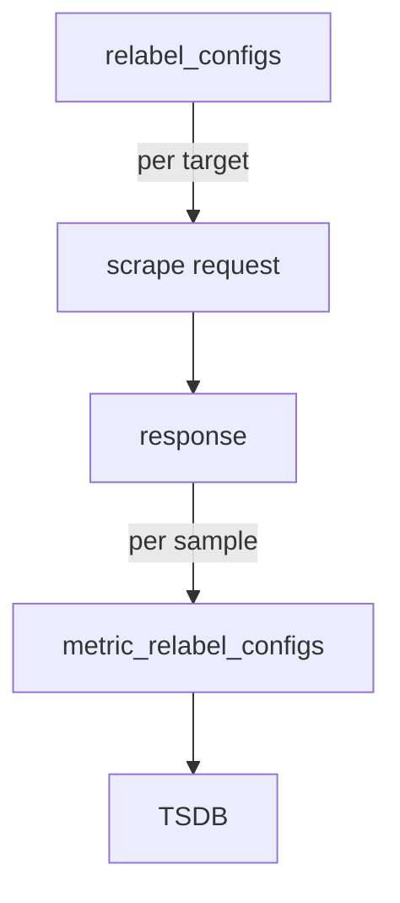

# Metric Relabeling And Label Conflicts

Some problems appear only after the scrape. An application may expose a metric that nobody needs, a label that creates thousands of series, or a label with the same name as a target label. Rules that run before the scrape cannot solve this, because they see no samples. This part covers the second list of rules, `metric_relabel_configs`, and the setting `honor_labels`, which decides who wins in a label conflict.

## Two lists, two moments

Prometheus applies relabeling twice for each scrape. `relabel_configs` runs once per target before the request, on the labels of the target. `metric_relabel_configs` runs after the response arrived, once for every sample, before the sample is stored.

The input of a `metric_relabel_configs` rule is the label set of one sample, including the label `__name__`, which holds the metric name. The labels of the target, such as `job` and `instance`, are already part of the sample. Because the rule sees one sample at a time, it can drop a single metric or a single label from a target that is otherwise healthy.



The diagram shows that target rules run first and sample rules run last, just before storage. A sample that a rule drops is never stored, and nothing else records that it existed, except the scrape series described later.

## Drop one metric

The `probe` application exposes the gauge `lab_queue_depth`. Assume that nobody uses it and you want to stop storing it, while every other metric of the job stays. The metric name is the value of `__name__`, so the rule matches that label and drops the sample.

<!-- astrona:playground:renew -->

Save this as `prometheus-config.yaml`:

```yaml
apiVersion: v1
kind: ConfigMap
metadata:
  name: prometheus-config
  namespace: starfleet
data:
  prometheus.yaml: |
    global:
      evaluation_interval: 2s
      scrape_interval: 2s
    rule_files:
    - /rules/*.yaml
    scrape_configs:
    - job_name: probe
      static_configs:
      - labels:
          team: starfleet
        targets:
        - probe:8080
      metric_relabel_configs:
      - source_labels: [__name__]
        regex: lab_queue_depth
        action: drop
    - job_name: prometheus
      static_configs:
      - targets:
        - localhost:9090
```

Apply it and load it:

```sh
kubectl apply -f prometheus-config.yaml
kubectl -n starfleet rollout restart deployment/prometheus
kubectl -n starfleet rollout status deployment/prometheus
```

Then check the result. Query the dropped metric and one that must stay:

```sh
kubectl -n starfleet exec shuttle -- wget -qO- 'http://prometheus:9090/api/v1/query?query=lab_queue_depth'
kubectl -n starfleet exec shuttle -- wget -qO- 'http://prometheus:9090/api/v1/query?query=lab_last_success_timestamp_seconds'
```

The first answer has an empty `result` list, and the second has one series. The application still exposes `lab_queue_depth`, and you can prove it by fetching `http://probe:8080/metrics` with `wget`. Prometheus received the sample and discarded it before storage.

## How the drop rule matched

The `drop` action removes the sample when the regex matches the joined source labels. Here the only source label is `__name__`, so the joined string is the metric name. The regex `lab_queue_depth` is anchored, so it matches that exact name and no other. To drop a family of metrics, use a pattern such as `lab_queue_.*`. A regex such as `lab_queue` without the tail matches nothing, because it does not cover the whole name.

The opposite action is `keep`. In `metric_relabel_configs`, `keep` stores only the samples that match and drops all others. It is a strong filter: a rule `source_labels: [__name__]`, `regex: lab_requests_total`, `action: keep` leaves a job with one metric. Use it with care.

You can check what the rules did to the volume. The series `scrape_samples_scraped` counts the samples that the target returned, and `scrape_samples_post_metric_relabeling` counts the samples left after the rules. Their difference is the number of dropped samples in one scrape. After the change above, the difference for the `probe` job is one.

## Removing a label

The action `labeldrop` removes labels whose names match the regex. It works on label names, and the `source_labels` field is not used. For example, the rule `regex: team`, `action: labeldrop` removes the label `team` from every sample of the job. It is the usual way to remove a high-cardinality label that an application exposes, because fewer distinct label values mean fewer series in storage.

Be careful with the target labels. `labeldrop` can remove `job` or `instance` too, if the regex matches them. Two series that differed only in the removed label then become the same series in one scrape, and Prometheus rejects the duplicates as an error. Drop only labels that you are sure do not separate series.

## Who wins in a label conflict

A conflict happens when the scraped text has a label with the same name as a target label, for example `instance` or `job`. The setting `honor_labels` decides the winner.

With the default `honor_labels: false`, the target labels win. Prometheus renames the scraped label to `exported_<name>` and attaches the target value. A scraped `job="batch"` becomes `exported_job="batch"` next to the target's `job="probe"`. With `honor_labels: true`, the scraped value wins and the conflicting target label is not attached. A sample that has no label of that name still gets the target label.

Use `true` only when the source is not the application itself. A Pushgateway holds metrics that other jobs pushed, and the pushed labels carry the real `job` and `instance`, so a job that scrapes it sets `honor_labels: true`. For an ordinary application, the default keeps the identity of the data under the control of the server.

## Choosing the right list

Choose by the thing you want to change. If the change is about the target, such as which targets, which address, which path or which target labels, use `relabel_configs`. If the change is about a sample, such as the metric name, a label of a series or a value of a label, use `metric_relabel_configs`. A rule in the wrong list does not give an error. It sees different labels, so it never matches or matches too much.

## Summary of the part

You know that `metric_relabel_configs` runs after the scrape on every sample, that the metric name is in `__name__`, and that `drop`, `keep` and `labeldrop` shape what reaches storage. You can show the effect with `scrape_samples_scraped` and `scrape_samples_post_metric_relabeling`. You also know that `honor_labels` decides the winner of a label conflict and that the default is the target.

## Common pitfalls

> [!WARNING]
> - Putting the metric drop rule into `relabel_configs`. That list never sees the metric name, so the metric stays stored.
> - Writing a partial name in the regex. The expression is anchored, so `lab_queue` does not match `lab_queue_depth`.
> - Using `keep` on `__name__` without listing all the metrics that you need. Every other metric of the job disappears.
> - Dropping a label that separates series. Two series then collide and the scrape reports duplicate samples.
> - Setting `honor_labels: true` for a normal application and losing control of `job` and `instance`.
