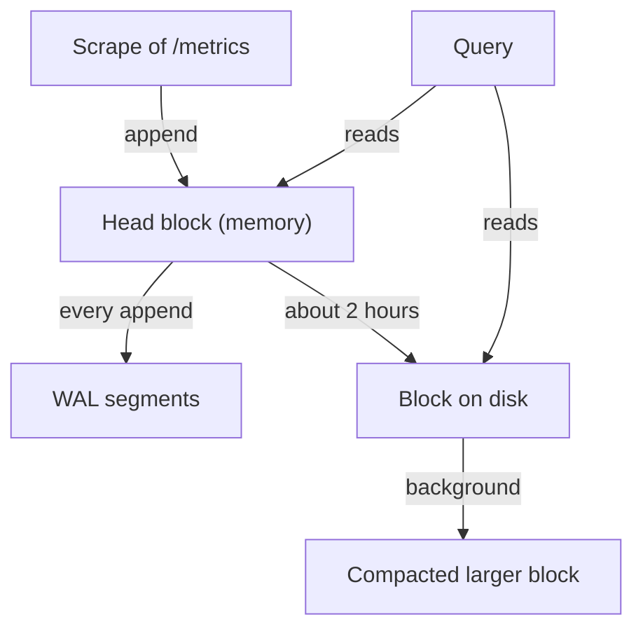

# The Local TSDB: Head, WAL And Blocks

Every limit of Prometheus that this module discusses comes from one design choice: the server stores its data itself, on a local disk, in its own time series database (TSDB). A TSDB is a database specialised for samples that arrive in time order, where each sample is a timestamp and a number belonging to one series. To judge how much data a server can hold, how fast it recovers from a crash and why it cannot be shared between servers, you first need a clear picture of how the TSDB writes data. This lesson follows one sample from the scrape to the disk.

## A sample enters the head block

When the scrape loop of Prometheus fetches the `/metrics` page of a target, it parses each line and appends the value to the time series with that name and label set. The place where the TSDB first stores the sample is the head block. The head block is a structure in memory that holds the most recent data, by default about the last two hours. Each active series has an entry in the head block with its labels and a small chunk of recent samples.

Because the head block lives in memory, two consequences follow. First, memory use grows with the number of active series, not with the number of samples per series. A series that receives one sample every two seconds costs almost the same memory as one that receives a sample every minute: the entry for the series is the expensive part. Second, a crash of the process would lose the head block, unless something else wrote the samples to disk. That something is the write-ahead log.

## The write-ahead log protects the head block

The write-ahead log (WAL) is a set of files on disk where the TSDB records every append before it counts the write as done. The files are called segments, and each segment is up to 128MB by default. The TSDB keeps at least three WAL segments. After a restart, the server reads the WAL from the start and rebuilds the head block in memory. This replay is the reason a Prometheus server with many series needs a long time to become ready after a restart: it must read all the recorded appends again.

The WAL is not a long-term store. It only covers the data that the head block still holds. Once the data moves into a block on disk, the matching WAL segments are truncated. This is also why the WAL counts toward the disk size limit, which the next lesson uses.

## The head block becomes a persistent block

At regular intervals, the TSDB compacts the oldest part of the head block into a block on disk. A block is an immutable directory that covers a fixed time range, and the first blocks cover two hours each. A block directory contains these items:

- A `chunks` directory with the compressed sample data, in segment files.
- An `index` file that maps metric names and label pairs to the series and their chunks.
- A `meta.json` file with the time range and statistics of the block.
- A `tombstones` file that records series deletions requested through the delete API.

Immutable means that Prometheus never edits a finished block. A query reads the blocks that overlap the requested time range and merges the result with the head block.



The diagram shows that the head block gets every sample first, the WAL mirrors the appends for crash recovery, and queries read from both the head block and the blocks on disk.

## Compaction merges blocks

Many small blocks are costly to query, because each query must open the index of every block that overlaps its time range. So a background process merges small blocks into larger ones. The first blocks cover two hours; later compaction merges them into blocks that cover a longer period, with an upper bound of 10 percent of the retention time or 31 days, whichever is smaller. Compaction also removes the data of deleted series. The process that does this is the compactor inside the Prometheus server itself. Nothing external is involved.

## Look at the running TSDB

The playground gives you a Prometheus server that has run for a short time. The data is small, but the structure is the same as on a production server. The commands run `wget` inside the `shuttle` pod and call the HTTP API of the `prometheus` Service.

<!-- astrona:playground:renew -->

Ask for the number of series in the head block:

```sh
kubectl -n starfleet exec shuttle -- wget -qO- 'http://prometheus:9090/api/v1/query?query=prometheus_tsdb_head_series'
```

The answer is a JSON document. The first element of the `value` list is the time of the evaluation, the second is the number of series as text. This is the cardinality of the head block at that moment. Run the command twice with a pause: the number stays almost constant, because the probe and the server expose a fixed set of series.

The status API gives a more detailed view of the head block:

```sh
kubectl -n starfleet exec shuttle -- wget -qO- http://prometheus:9090/api/v1/status/tsdb
```

Look for `headStats`. It has `numSeries`, `numLabelPairs`, `chunkCount`, `minTime` and `maxTime`. The same document lists `seriesCountByMetricName` and `labelValueCountByLabelName`. These two lists are the first place to look when a server uses too much memory, because they show which metric or which label creates the most series.

The server also measures its own TSDB. Try these metrics one at a time with the same query command:

- `prometheus_tsdb_head_chunks`: the number of chunks in the head block.
- `prometheus_tsdb_blocks_loaded`: the number of blocks currently open on disk.
- `prometheus_tsdb_wal_segment_current`: the index of the WAL segment that receives appends.
- `prometheus_tsdb_head_samples_appended_total`: a counter that grows with every appended sample.

A new playground has probably not yet reached the first two-hour boundary, so the number of loaded blocks can be 0. That is normal: all data is still in the head block and the WAL. The blocks appear only after the head block has covered enough time to be compacted.

## What this design means in practice

Because the TSDB writes to a local directory, the data belongs to this one server process and its disk. There is no network protocol that sends a sample to a second server. If the disk is lost, the data is lost. If the process is stopped for a long time, the scrapes during that time are never collected, because Prometheus pulls the data and cannot fetch the past. Later lessons build on these two facts.

You now know where a sample lives at each stage: the head block and the WAL for roughly the last two hours, and blocks on disk for everything older. The open question is how long the blocks stay and who decides when to delete them, which is the job of the retention flags.

## Common pitfalls

> [!WARNING]
> - Do not call the head block "the database". It holds only the recent data; older data is in blocks on disk.
> - Do not delete files in the data directory by hand while the server runs. The WAL, the blocks and the index depend on each other, and a manual deletion can corrupt the data.
> - A restart does not lose the head block when the data directory survives, but the replay of the WAL takes time. A server with many series can need minutes to become ready.
> - An `emptyDir` volume is discarded when its pod is removed, so the history is lost. Use a persistent volume on a real server.
