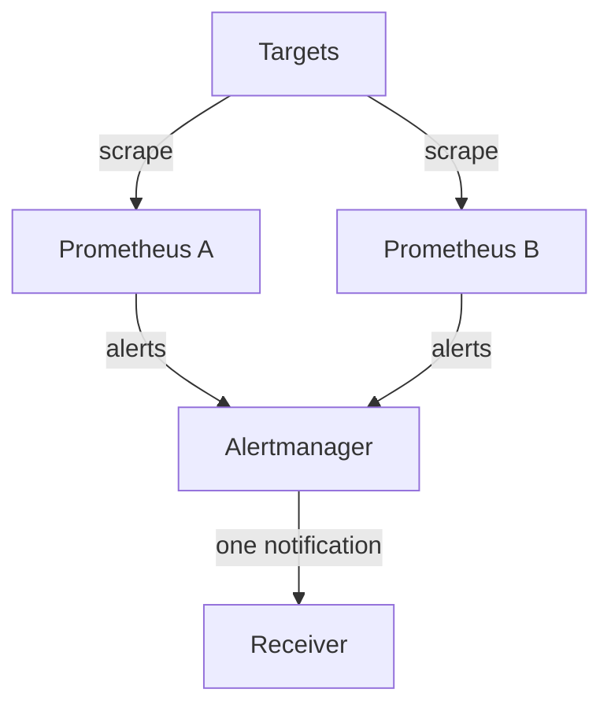

# Single Node, Cardinality And High Availability Pairs

A Prometheus server is one process with one local database. It is fast and simple for that reason, but it also means that the server cannot grow past the machine it runs on, and it cannot share its data with a second server. This lesson explains the limits of the single-node design, the cost that each time series adds, and the usual way to get high availability: two identical servers that scrape the same targets. It also shows what that pair does not give you.

## No clustering and no replication

Prometheus has no cluster mode. There is no leader election, no sharding of series between servers and no protocol that copies samples from one server to another inside the TSDB. The storage documentation says it directly: local storage is not clustered or replicated. Two consequences follow.

First, the server cannot scale out in a simple way. If one server is too small, you can add memory and disk to it, or you can split the targets among several independent servers, for example one server per team or per region. Each server then holds only its own part of the data, and no single server can answer a query over all of it.

Second, the data is not durable against the loss of the disk or the node. A lost volume means lost history. A server that is stopped does not scrape, and Prometheus cannot collect the missed samples afterwards, because it reads the current value of a target and not the past. Anything that needs the data to survive, or to cover the whole company, must be added outside the TSDB. The next module covers that option.

## The cost of cardinality

Cardinality is the number of time series that the server tracks. Each unique combination of a metric name and label values is one series. A metric `lab_requests_total` with the label `status` that has two values makes two series. Add a label `path` with 50 values, and the metric makes 100 series. The cost multiplies with every label.

An active series costs memory in the head block, even when its value never changes. It also costs disk space and index size, and every query that selects it must read it. A rough rule from practice is that each active series needs a few kilobytes of memory. A server with one million series therefore needs several gigabytes of memory for the head block alone, before queries run. The exact number depends on the label sizes and the version, so measure your own server instead of using a fixed figure.

A label that has an unbounded set of values is the usual cause of trouble. Examples are a user id, a request id, an email address or a ticket number. Each new value creates a new series, and the old series stay in the head block until they have no new samples and the head block is compacted. A metric like this is called a high-cardinality metric. The next module uses an application that exposes one series per open support ticket, to show what the server does with such data.

Look at the series on the playground server. The status API lists the metrics that own the most series:

<!-- astrona:playground:renew -->

```sh
kubectl -n starfleet exec shuttle -- wget -qO- http://prometheus:9090/api/v1/status/tsdb
```

Find `seriesCountByMetricName`. It is a list of objects with a `name` and a `value`, ordered from the largest. The list tells you which metric names create the most series. Then find `labelValueCountByLabelName`. It shows which label names have the most distinct values. In a real incident, you start here, find the label with an unexpected number of values and fix the instrumentation or drop the label in the scrape configuration.

You can also count series by a query. This query counts all series that the server has for the metric of the probe:

```sh
kubectl -n starfleet exec shuttle -- wget -qO- 'http://prometheus:9090/api/v1/query?query=count(lab_requests_total)'
```

The probe has one label `status` with two values, so you can predict the number before you read the answer. Predicting the count from the labels is the skill that prevents a cardinality problem: before a label is added, multiply the number of possible values of each label.

## Query cost grows with series too

A query reads every series that its selector matches, over the whole time range. A selector with no label matchers for a metric with 100000 series loads all 100000 series. This is why the query limits from the retention lesson exist, and why a wide query is slow even on fast disks. Recording rules help here: a rule computes an aggregated result on a schedule and stores it as a new, small series, and dashboards then query the small series.

## High availability with a pair of servers

Because one server is a single point of failure, the standard answer is to run two identical Prometheus servers. Both have the same configuration and scrape the same targets. If one fails, the other has data, and the alerting rules of the other server still evaluate.

The two servers do not talk to each other. Each scrapes on its own timer, so the timestamps of the samples differ slightly and the values can differ a little, because the two scrapes see the target at different moments. The data of the two servers is similar but not identical. Three practical points follow.

- Each server needs an external label that identifies it, such as `replica: a` and `replica: b`. External labels are attached to data that leaves the server, for example in alerts and remote write.
- Both servers send their alerts to Alertmanager. Alertmanager merges alerts that have the same labels, so you receive one notification and not two. The alerts of the two servers must be the same apart from the replica label, and the replica label is normally removed on the Alertmanager side by configuration.
- A dashboard reads from one server. If that server is down, the dashboard fails, unless another layer in front of the pair chooses an available server or merges the two results.

An HA pair therefore protects against the failure of one server. It does not give you more capacity, because each server stores and processes all data. It does not give you one combined database, because the two TSDBs are separate. It does not protect against a failure of both servers, a wrong configuration that you copy to both, or a failure of the shared storage if both use the same volume class.



The diagram shows two independent servers that scrape the same targets and send duplicate alerts, which Alertmanager reduces to one notification.

## Duplicates in queries

When you query the data of two replicas through a tool that merges them, you get two series for each real series, which differ in the replica label. A sum over both double-counts the target. To get a correct result you either query a single replica, or you ignore or aggregate away the replica label with an operator such as `max without (replica)`, which takes the larger value of the two copies. For a counter, remember that each replica missed different scrapes, so neither copy is complete. This is one more reason why the exact value of a Prometheus metric is an estimate and not a ledger entry.

## Splitting the work between servers

When one server is too large, you divide the scrape targets among several independent servers. This is called functional sharding when you split by purpose, for example one server for the infrastructure and one for each product, and it is called horizontal sharding when you split the targets of one job among servers by a hash of the target address. In both cases, each server is still a normal single-node Prometheus with its own TSDB.

The price is that no server sees all data. A query that must combine data from two servers needs another system on top, such as a server that federates selected series from the others. Federation means that one Prometheus server scrapes the `/federate` endpoint of another and stores a chosen subset of its series. It is meant for aggregated series and not for copying everything, because the second server then pays the full cardinality cost again.

## What a restart costs

Capacity planning must include the restart. On start, the server loads the block indexes and replays the WAL into the head block. A server with a large head block needs time and extra memory for this replay, and it does not answer queries or scrape until it is ready. The `/-/ready` endpoint of the server reports when it is ready. This is a reason to keep the head block small and a reason to run a second server in a pair: during the replay of one server, the other one keeps scraping.

## Summing up

You now know that Prometheus is a single-node system, that cardinality sets the memory cost, and that an HA pair is two independent servers that duplicate the data and the alerts. You also know what the pair does not give you: capacity, one database and durability of the data. The summary of the module follows, and the next module looks at the questions that Prometheus is not designed to answer at all.

## Common pitfalls

> [!WARNING]
> - Do not call two servers a cluster. They do not exchange data, and they hold similar but not identical samples.
> - Do not sum the series of both replicas. You double-count. Select one replica or aggregate the replica label away.
> - Do not add a label whose values are unbounded, such as a user id or request id. Each value is a new series with its own memory cost.
> - Do not scale by adding memory forever. At some size you must split the targets among several servers.
> - An HA pair does not keep history if both servers lose their disks. Durable, long-term storage needs a system outside Prometheus.
