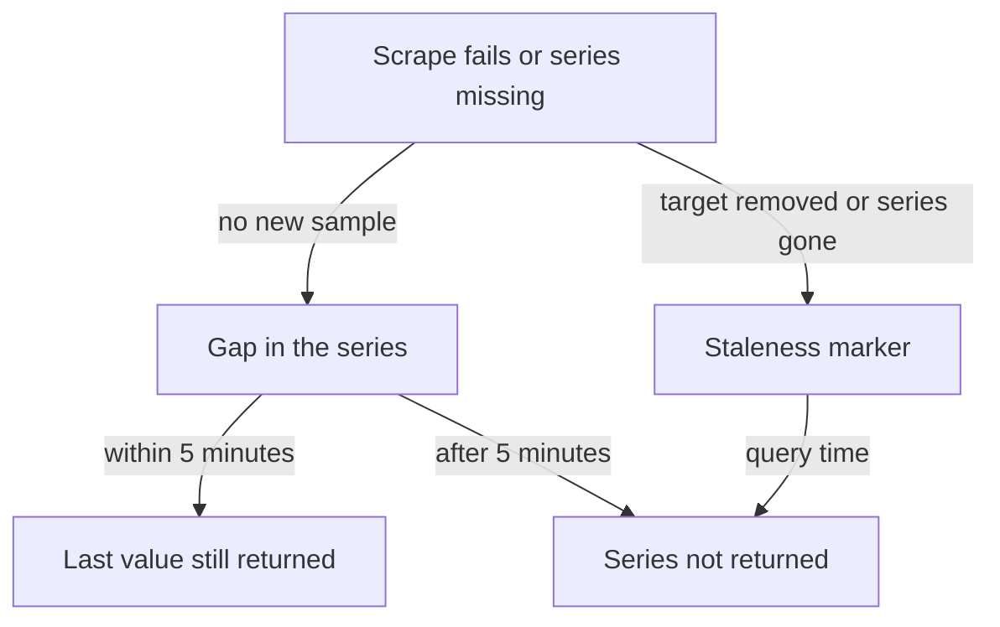

# Pull Model, Staleness, Long-Term Storage And Alert Delivery

Prometheus does not wait for applications to send data. It goes out and fetches the data itself, on a timer. This pull model keeps the server in control of the load and makes a missing target easy to see, but it also decides what Prometheus can and cannot observe. This lesson covers four limits that follow from the design: what the server can reach, how it treats missing data, how long data stays, and how far an alert can be trusted to arrive.

## What the pull model can reach

A scrape is an HTTP request that the Prometheus server sends to the `/metrics` path of a target. For the scrape to work, three things must be true. The target must be running at the time of the scrape, it must expose an HTTP endpoint with the text exposition format and the network must allow a connection from the server to the target address. Each requirement creates a limit.

A target behind a firewall or a network address translation (NAT) gateway that does not allow incoming connections cannot be scraped. A short-lived job, such as a batch task that finishes in five seconds, can start and stop between two scrapes, so the server never sees it. A process that cannot serve HTTP has no endpoint to scrape. For short-lived jobs, the Pushgateway exists: the job pushes its final values to the Pushgateway, and Prometheus scrapes the Pushgateway. The Pushgateway is meant for the results of batch jobs and not as a general way to push all metrics, because it keeps the last pushed value forever and hides whether the job is still alive.

Prometheus also sees only the moments at which it scrapes. With a scrape interval of 15 seconds, anything that rises and falls between two scrapes is invisible. A gauge that jumps to 100 for four seconds and returns to 5 does not appear in the data.

## Gaps and the up series

If a scrape fails, Prometheus stores no samples for that target at that time. The only trace is the automatic series `up`, which the server creates for every target. It has the value 1 when the scrape succeeded and 0 when it failed. The scrape also records `scrape_duration_seconds` and `scrape_samples_scraped`. So a gap in a graph has two possible meanings: the target had no data, or the target could not be scraped. Only `up` tells them apart.

<!-- astrona:playground:renew -->

Look at the automatic series of the playground targets:

```sh
kubectl -n starfleet exec shuttle -- wget -qO- 'http://prometheus:9090/api/v1/query?query=up'
```

You see one result per target with the labels `job` and `instance`. A value of 1 means the last scrape worked. Now read the target list, which also reports the time and duration of the last scrape and the last error:

```sh
kubectl -n starfleet exec shuttle -- wget -qO- 'http://prometheus:9090/api/v1/targets?state=active'
```

Find `lastScrape`, `lastScrapeDuration`, `health` and `lastError`. For a healthy target, `lastError` is empty. This API is the first place to look when a series stops: it says whether the server could reach the target and what went wrong.

## Staleness

When you run an instant query, Prometheus must decide which sample belongs to the query time. It takes the newest sample of each series that is not older than the lookback period. The lookback period is five minutes by default, and the flag `--query.lookback-delta` changes it. If a target stops answering, its series keep returning their last value for up to five minutes, unless the server marks them stale.

Staleness markers solve this. A staleness marker is a special sample that tells queries "this series has ended". Prometheus writes it when a target is removed, and when a scrape or a rule evaluation no longer returns a series that it returned before. After the marker, an instant query does not return the series at once, and a graph shows a gap and not a flat line. Targets that expose their own timestamps are the exception: their series keep the last value for the lookback period.

Two practical effects follow. A series that disappears from the output of an application leaves the query results immediately, and its old samples remain in the database until retention removes them. And an alert on a metric that no longer exists never fires, because the expression returns an empty result. To alert on a missing target, use `up == 0`, or use the function `absent()` for a metric that should exist.



The diagram shows that a missing sample leads to a gap, and that the series leaves the query result either at once, through a staleness marker, or after the lookback period.

## Long-term storage

The local TSDB keeps 15 days by default, and the server is single-node. Some uses need more: a year of capacity trends, data shared by several servers or a copy that survives the loss of a disk. Prometheus does not provide this inside the server. It provides an interface instead: remote write.

Remote write is a setting in the Prometheus configuration. The `remote_write` section lists endpoints, and Prometheus sends a copy of each sample, in batches, to them over HTTP while it also stores the sample locally. The receiving system is a separate product built for long-term, large or replicated storage. The Prometheus remote write protocol is a stable specification, so many systems accept it. Prometheus can also read data back from a remote system through remote read, but only the raw series are fetched, and the PromQL evaluation still runs inside Prometheus. The remote read protocol is not considered stable.

Remote write does not turn Prometheus into a cluster. The local database stays local, with its own retention. Remote write also has its own limits. The server keeps outgoing samples in a queue in memory and in the WAL. If the remote endpoint is down for a long time, the queue can fall behind and the server can drop samples that have left the WAL. The server reports this with its own metrics, such as `prometheus_remote_storage_samples_pending`, which you can watch. The remote system holds a copy that is only as complete as the delivery was.

## Alert delivery

An alerting rule is an expression that Prometheus evaluates on a timer. When the expression returns data, the alert becomes pending and then firing. The Prometheus server then sends the firing alerts to Alertmanager, the component that groups, silences and routes them. Alertmanager sends the notifications to receivers such as email, a chat system or a webhook.

Every step can fail, and Prometheus does not guarantee delivery end to end. The rule evaluation can fail or run late when the server is overloaded. The alerts go to Alertmanager over HTTP, and the server counts the failed and dropped sends in `prometheus_notifications_errors_total` and `prometheus_notifications_dropped_total`. Alertmanager retries notifications to a receiver, but a receiver that stays down can lose a notification. And if the Prometheus server itself is down, no rule is evaluated and no alert is sent, so the system that should warn you about the failure is silent.

Check the notification metrics on the playground server:

```sh
kubectl -n starfleet exec shuttle -- wget -qO- 'http://prometheus:9090/api/v1/query?query=prometheus_notifications_sent_total'
```

If this playground has no Alertmanager configured, the result list can be empty, because the server has not tried to send. That absence is itself information: the metric exists only after the notification path is in use.

The answer to unreliable delivery is monitoring of the pipeline. Run two servers as an HA pair, so one failure does not stop alerting. Add an alert that always fires, often called a watchdog or dead man's switch alert, and send it to an external service that raises its own alarm when the alert stops arriving. This detects a broken pipeline from outside. An end-to-end test that sends a test alert through the whole path gives the same kind of confidence.

You now know the reach limits of the pull model, how gaps and staleness behave, how remote write adds long-term storage without changing the server and why alert delivery needs its own monitoring. The remaining danger is a target that sends too much data, which can harm the server before any of these limits matter.

## Common pitfalls

> [!WARNING]
> - Do not read a gap in a graph as "the application was idle". Check `up` and the target `lastError` first.
> - Do not alert only on a metric from a target. If the target disappears, the expression returns nothing and the alert stays silent. Alert on `up == 0` as well.
> - Do not use the Pushgateway for long-running services. It keeps the last value and hides a dead process.
> - Remote write is a copy for another system. It does not give the local server clustering or longer local retention.
> - Do not assume that a firing alert always reaches a person. Monitor the Prometheus server, Alertmanager and the receiver, and keep a watchdog alert.
