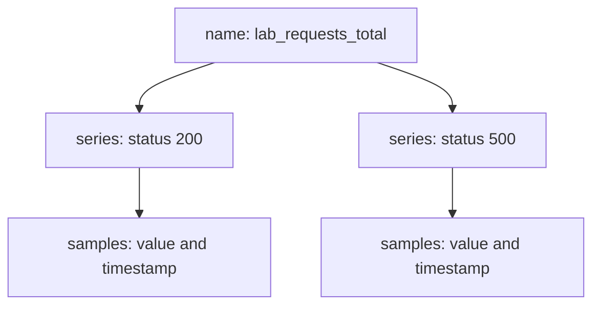

# Series, Samples, Names And Labels

Every number that Prometheus stores has to be found again later. A query cannot ask for "the third value I scraped". It asks for a name and some labels, and Prometheus returns the series that match. This chapter shows how a series is built, what a sample is, which characters names may use and which conventions keep names readable.

## A series is a name plus labels

Prometheus is a time series database. A **time series** is a stream of values for one measured thing, ordered by time. A **sample** is one point in that stream: a value and a timestamp with millisecond precision. The value is a 64-bit floating-point number. Newer versions can also store a native histogram as a value, but the examples in this module use floats.

The identity of a series is its metric name and its full set of **labels**. A label is a key and a value that adds a dimension to a metric. The application `probe` exposes the counter `lab_requests_total` with the labels `service` and `status`. Prometheus writes one series like this in its notation:

```text
lab_requests_total{service="probe", status="200", job="probe", instance="probe:8080", team="starfleet"}
```

This is one series. The labels `service` and `status` come from the application. The labels `job`, `instance` and `team` come from Prometheus, which adds them when it scrapes the target. The `job` label comes from the `job_name` in the scrape configuration, `instance` is the address of the target, and `team` is a label set in the static configuration of the job.

If any label value differs, the result is a different series. The request counter for `status="500"` is a second series with the same name and a different label set. Each series has its own list of samples, and Prometheus stores and compares them separately.



The diagram shows that one metric name leads to one series for each label set, and that each series holds its own samples.

## The name is a label

Inside Prometheus the metric name is stored as the label `__name__`. The selector `lab_requests_total` is a short form of `{__name__="lab_requests_total"}`. This explains two things you meet often. First, a function such as `sum` removes `__name__` from its result, because the result is no longer the original metric. Second, you can select by name pattern, for example every metric whose name starts with `lab_`, with `{__name__=~"lab_.*"}`.

Label names that start with two underscores are reserved for Prometheus. `__name__` is one of them. Other examples are `__address__` and `__scheme__`, which exist while a target is being discovered and relabelled, and `__meta_` labels from service discovery. An application must never define a label that starts with `__`. Prometheus also drops most of these labels before it stores a series, so you rarely see them in query results.

A label with an empty value is the same as a label that does not exist. If a series has `team=""`, Prometheus treats it exactly like a series without a `team` label. This matters for matchers, which depend on this rule.

## Look at real series

You can ask Prometheus for the series that the playground holds. The helper below calls the HTTP API from the pod `shuttle`. It sends the PromQL expression in the query string and prints the JSON answer on one line. A **PromQL** expression is a query written in the Prometheus query language.

<!-- astrona:playground:renew -->

```sh
query_prometheus() {
  kubectl -n starfleet exec shuttle -- python -c 'import sys,urllib.parse,urllib.request; print(urllib.request.urlopen("http://prometheus:9090/api/v1/query?" + urllib.parse.urlencode({"query": sys.argv[1]})).read().decode())' "$1"
}
```

Paste it once in your terminal. Then ask for the request counter:

```sh
query_prometheus 'lab_requests_total'
```

The answer has a `data.result` list with two entries. Each entry has a `metric` object with the labels, and a `value` pair with a timestamp in seconds and the sample value as a string. One entry has `status` set to `200` and the other has `500`. Both have `__name__`, `service`, `job`, `instance` and `team`. The values keep growing while the traffic generator runs, so run the command twice and compare them.

Now select by the name label instead of the name:

```sh
query_prometheus '{__name__=~"lab_.*"}'
```

This returns every series whose name starts with `lab_`: the request counter, the queue gauge, the success timestamp gauge and the series of the histogram. Notice that the histogram has more series than the other metrics, because each bucket is its own series. A histogram stores each bucket as its own series.

## Ask which names and labels exist

Prometheus can list its own label names and values. The first command lists all label names that occur in the stored series. The second lists the values of the label `status`:

```sh
kubectl -n starfleet exec shuttle -- wget -qO- http://prometheus:9090/api/v1/labels
kubectl -n starfleet exec shuttle -- wget -qO- http://prometheus:9090/api/v1/label/status/values
```

The first answer contains `__name__`, `instance`, `job`, `service`, `status` and `team`, among others. The second contains the two values `200` and `500`. This is the quickest way to learn what a new target exposes without reading its source code.

## Rules for names

A metric name should match the pattern `[a-zA-Z_:][a-zA-Z0-9_:]*`. A label name should match `[a-zA-Z_][a-zA-Z0-9_]*`. Since Prometheus version 3.0 both may contain any UTF-8 characters, but names outside the patterns need quoting in PromQL, and much of the surrounding tooling does not expect them. Stay with the patterns.

The colon is reserved. Only recording rules should put a colon in a metric name, as in `status:lab_requests:rate1m`. Exporters and instrumented applications must not use it. A label value can be any text, including an empty string.

## Naming conventions

Conventions make names readable and keep graphs correct. They are not enforced by Prometheus, but exporters and the exam follow them.

- A name starts with the application or domain it belongs to, as a single word. Examples are `prometheus_`, `http_` or `lab_`. The prefix avoids collisions between applications.
- A name uses base units: seconds, bytes, meters, not milliseconds or kilobytes. The unit is a suffix in plural form, such as `_seconds` or `_bytes`. A ratio between 0 and 1 uses `_ratio`.
- A counter ends in `_total`. This is how `lab_requests_total` is written.
- A timestamp ends in `_timestamp_seconds`, like `lab_last_success_timestamp_seconds`.
- A name must not contain the names of its labels, and it must not change meaning when you sum it across a label. A metric named `lab_requests_total` is correct, but `lab_requests_by_status_total` is not, because `status` is a label.
- Use a label for a dimension and a separate metric only for a different thing. Summing a metric over all its label values should give a meaningful total, or the label should not exist.

The last rule is the one people break most often. A metric `lab_queue_depth{queue="a"}` and `lab_queue_depth{queue="b"}` can be summed into the total depth of both queues. A metric whose labels hold both bytes used and bytes free under the same name cannot be summed in a useful way.

## Type is metadata, not identity

The type of a metric (counter, gauge, histogram or summary) is not part of the series identity. The application declares it in a `# TYPE` line in the exposition text. Prometheus keeps it as metadata and returns it from the metadata API:

```sh
kubectl -n starfleet exec shuttle -- wget -qO- 'http://prometheus:9090/api/v1/metadata?metric=lab_queue_depth'
```

The answer lists the metric with the type `gauge` and its help text. Because the type is only metadata, Prometheus will let you call any function on any series. Choosing the function that fits the type is your job, and the sections on counters, gauges and histograms show how.

You now know that a series is a metric name plus labels, that a sample is a value with a timestamp, that the name is the reserved label `__name__`, and which conventions a good name follows. The open question is what the value of a sample means. That depends on the metric type, and the counter comes first.

## Common pitfalls

> [!WARNING]
> - **Thinking the type is stored with the series.** The type is metadata from the `# TYPE` line. Prometheus does not stop you from using `rate` on a gauge.
> - **Defining labels that start with `__`.** These names are reserved for Prometheus internals. Instrumentation must not use them.
> - **Putting a variable value into the metric name.** A name such as `requests_200_total` makes one metric for each status. Put the status in a label.
> - **Expecting an empty label to be visible.** A label with an empty value equals a missing label, so `status=""` selects series that have no `status` at all.
> - **Using units other than base units.** A metric in milliseconds forces everyone who uses it to convert, and mixes badly with the seconds that other metrics use.
