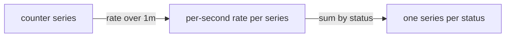

# Counters And Gauges

A sample value alone says little. The number 5000 could be the total of all requests since the application started, or the number of requests that wait in a queue right now. The metric type tells you which of the two it is. This chapter covers the two simplest types, the counter and the gauge, and the PromQL functions that give a useful answer for each.

## Counters only go up

A **counter** is a metric whose value only increases while the process runs. It starts at zero when the application starts, and the application adds one for each event. The counter `lab_requests_total` in the example application counts completed requests, one series for each `status`. When the process restarts, the counter starts again at zero. That is a **counter reset**.

The raw value of a counter is the total since the last start. This number depends on how long the application has run, so it is a poor answer to the question "how busy is the service now". Look at the current values first. The helper below sends a PromQL expression to the Prometheus HTTP API from the pod `shuttle`:

<!-- astrona:playground:renew -->

```sh
query_prometheus() {
  kubectl -n starfleet exec shuttle -- python -c 'import sys,urllib.parse,urllib.request; print(urllib.request.urlopen("http://prometheus:9090/api/v1/query?" + urllib.parse.urlencode({"query": sys.argv[1]})).read().decode())' "$1"
}
```

```sh
query_prometheus 'lab_requests_total'
```

Run the query two times with a few seconds between them. The values for both `status` labels grow. The traffic generator sends one request every quarter of a second, and every tenth request asks the application to answer with status 500. The value for `200` therefore grows about nine times faster than the value for `500`.

## Range vectors and rate

To measure the speed of growth, PromQL needs more than the latest sample. It needs the samples of a time window. A **range vector selector** adds a duration in square brackets to a selector: `lab_requests_total[1m]` selects all samples of each matching series from the last minute. Try it:

```sh
query_prometheus 'lab_requests_total[10s]'
```

The result type is `matrix`. Each series has a list of `values`, and each entry is a timestamp with a value. Because Prometheus scrapes `probe` every two seconds, a ten-second window holds about five samples for each series.

The function `rate` works on such a window. It takes the first and the last sample in the window, adds up the increases between all samples, and divides the result by the length of the window in seconds. It returns the average increase per second. Run it:

```sh
query_prometheus 'rate(lab_requests_total[1m])'
```

You get one value for each input series. The value for `status="200"` is close to 3.6 and the value for `status="500"` is close to 0.4, because the generator sends four requests per second and every tenth fails. The numbers are close to these values and not equal, because the window edges rarely match a sample exactly. `rate` extrapolates to the edges of the window, so it returns an estimate.

`rate` also handles counter resets. If a sample is lower than the one before it, `rate` assumes a reset and counts the new value from zero. That is the reason to use `rate` on counters, and nothing else, for speed. The function `increase` returns the total increase over the window, which equals `rate` multiplied by the number of seconds in the window. The function `irate` uses only the last two samples of the window, so it reacts faster and is noisier.

A rule of thumb is to use a window of at least four scrape intervals. With a scrape interval of two seconds in this playground, `1m` is more than enough. If the window holds fewer than two samples, the function returns no result for that series.

## Aggregate after rate, never before

`rate` returns one series for each label set, so the result still has `service`, `job`, `instance` and `team`. To answer "how many requests per second for each status", you aggregate. An **aggregation operator** such as `sum` combines many series into fewer. The clause `by (status)` keeps the label `status` and removes all others:

```sh
query_prometheus 'sum by (status) (rate(lab_requests_total[1m]))'
```

You get two series, each with only the label `status`. The order matters: write `sum(rate(...))`, not `rate(sum(...))`. If you sum the counters first, a reset in one series makes the sum drop, and `rate` can no longer tell a reset from a real decrease. Always take the rate of each series, then sum.



The diagram shows the correct order: rate on each series first, aggregation second.

## Gauges go up and down

A **gauge** is a metric whose value can increase and decrease. The gauge `lab_queue_depth` shows the number of queued items now. The gauge `lab_last_success_timestamp_seconds` holds the Unix time of the last successful request. Typical gauges are memory in use, temperature, the number of running pods and the size of a queue.

A gauge sample already means something by itself. Read it directly:

```sh
query_prometheus 'lab_queue_depth'
```

The value is 3, because the example application reports a constant queue depth. Aggregate gauges with `sum`, `avg`, `min` or `max`. To find the highest depth over all series, use `max(lab_queue_depth)`. A gauge that changes quickly can be summarised over time with functions such as `avg_over_time` and `max_over_time`, which take a range vector.

The timestamp gauge gives an age. The PromQL function `time()` returns the current evaluation time in seconds, so `time() - lab_last_success_timestamp_seconds` is the number of seconds since the last successful request. This is a common freshness check.

## Never use rate on a gauge

`rate` on a gauge is a mistake that does not cause an error. A gauge that falls from 5 to 3 is not a counter reset, but `rate` treats every decrease as a reset and adds the new value as an increase. The result looks like a number and has no meaning. Try it on the constant gauge:

```sh
query_prometheus 'rate(lab_queue_depth[1m])'
```

The result is 0 because the gauge does not change, and that makes the mistake look harmless. When the gauge changes, the answer is wrong. For a gauge that you want to know the change of, `deriv` and `delta` are the right functions.

The reverse mistake is also common. A raw counter in a graph is a line that only rises, and a line that falls is a sign of a reset. If you see a dashboard panel with a raw `_total` series, the author probably forgot `rate`.

## A recording rule for a rate

Queries like `sum by (status) (rate(lab_requests_total[1m]))` run each time a dashboard refreshes. A **recording rule** evaluates an expression on a fixed interval and stores the result as a new series, so the dashboard reads one stored series. Prometheus loads rule files listed under `rule_files` in its configuration. In the playground the rule file comes from the ConfigMap `prometheus-rules`, key `rules.yaml`.

The naming convention for recorded series is `level:metric:operations`. The level lists the labels the result keeps, the metric is the original name without `_total`, and the operations list the functions that were applied, newest first. Save this as `rules-age.yaml`. It records the age of the last success, which uses a gauge, so no rate is involved:

```yaml
apiVersion: v1
kind: ConfigMap
metadata:
  name: prometheus-rules
  namespace: starfleet
data:
  rules.yaml: |
    groups:
    - name: freshness
      interval: 5s
      rules:
      - record: lab:last_success_age_seconds:max
        expr: time() - max(lab_last_success_timestamp_seconds)
```

Apply it:

```sh
kubectl apply -f rules-age.yaml
```

Then check the result. Prometheus does not reload a changed rule file by itself, so restart it and query the new name after a few seconds:

```sh
kubectl -n starfleet rollout restart deployment/prometheus
kubectl -n starfleet rollout status deployment/prometheus
query_prometheus 'lab:last_success_age_seconds:max'
```

The value is small, because the traffic generator succeeds several times each second. A restart empties the data directory in this playground, so the first query can take a short while to return a value.

You now know that a counter needs `rate` and then an aggregation, that a gauge is read or aggregated directly, and that a recording rule stores the result under a name that records its level and operations. The open question is the third kind of measurement: a distribution of values, such as request duration, which neither type can describe.

## Common pitfalls

> [!WARNING]
> - **Graphing a raw counter.** The raw value is the total since the last restart, and it falls to zero on a reset. Use `rate` or `increase`.
> - **Summing before rate.** `rate(sum(counter[1m]))` is not valid, and a subquery that does the same hides resets. Take the rate of each series and then sum.
> - **Using `rate` on a gauge.** A decrease of a gauge is not a reset. `rate` returns a number with no meaning. Use `delta` or `deriv`.
> - **Using a window that is too short.** A window with fewer than two samples returns nothing. Use at least four scrape intervals.
> - **Expecting exact values from `rate`.** It extrapolates to the window edges and returns an estimate. Round numbers are not a sign of a correct query.
