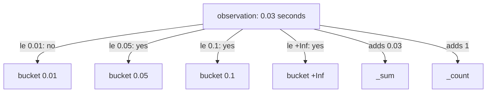

# Histograms And Summaries

A request count tells you how many requests happened. It does not tell you how long they took. An average duration hides the slow requests that users notice, so operators ask for percentiles: the duration that 95 percent of requests stay below. A single number cannot hold a distribution, so Prometheus has two more metric types for it, the histogram and the summary. This chapter explains how each one stores a distribution and how to get a percentile from it.

## What a histogram stores

A **histogram** counts observations in buckets. An observation is one measured value, such as the duration of one request. Each **bucket** has an upper bound, and it counts every observation that is less than or equal to that bound. The buckets are cumulative: a bucket with a larger bound includes everything the smaller buckets count.

A histogram appears as several series with a common name. Each bucket is a counter series with the suffix `_bucket` and a label `le`, which means "less than or equal to". The series `_count` counts all observations, and the series `_sum` adds up all observed values. The last bucket has the bound `+Inf` and always equals `_count`.

The application `probe` exposes the histogram `lab_request_duration_seconds` with the bucket bounds 0.01, 0.05, 0.1 and `+Inf` seconds. Look at the series:

<!-- astrona:playground:renew -->

```sh
query_prometheus() {
  kubectl -n starfleet exec shuttle -- python -c 'import sys,urllib.parse,urllib.request; print(urllib.request.urlopen("http://prometheus:9090/api/v1/query?" + urllib.parse.urlencode({"query": sys.argv[1]})).read().decode())' "$1"
}
```

```sh
query_prometheus 'lab_request_duration_seconds_bucket'
```

The answer has four series, one for each value of `le`: `0.01`, `0.05`, `0.1` and `+Inf`. The values never decrease from one bound to the next, because each bucket includes the ones before it. Now compare the last bucket with the count:

```sh
query_prometheus 'lab_request_duration_seconds_count'
```

The value equals the value of the `+Inf` bucket. A bucket series is a counter, as are `_sum` and `_count`. They only grow, and they reset when the application restarts. This means every histogram calculation starts with `rate`.



The diagram shows what happens for one observation of 0.03 seconds: it increments every bucket whose bound is at least 0.03, adds its value to `_sum` and adds one to `_count`.

## Average duration from sum and count

The simplest use of the two extra series is an average. Divide the rate of `_sum` by the rate of `_count`. Both rates cover the same window, so the result is the average duration of the requests in that window:

```sh
query_prometheus 'rate(lab_request_duration_seconds_sum[1m]) / rate(lab_request_duration_seconds_count[1m])'
```

The value is a number of seconds. Each request in the example application sleeps about 10 milliseconds, so expect a value a little above 0.01. An average is cheap and exact, but it says nothing about the slowest requests.

## Percentiles with histogram_quantile

To estimate a percentile, use `histogram_quantile`. It takes a quantile between 0 and 1 and a set of bucket series. A **quantile** is the value below which a given fraction of observations fall, so 0.95 means the 95th percentile. The function needs the label `le` on its input, because it reads the bucket bounds from it.

Write the query in three steps. First take the rate of the buckets, so that the result reflects the last minute and not the whole run time of the application. Second, sum by `le`, which merges the series of all instances and keeps the bucket structure. Third, call the function:

```sh
query_prometheus 'histogram_quantile(0.95, sum by (le) (rate(lab_request_duration_seconds_bucket[1m])))'
```

The answer is one series without labels and a value in seconds. It is an estimate. Prometheus finds the bucket in which the 95th percent of observations falls and assumes that the observations inside that bucket are spread evenly. It then interpolates linearly between the lower and the upper bound.

Two consequences follow. First, the result can never be more precise than the bucket width. If a bucket spans 0.05 to 0.1 seconds, the answer inside it can be off by up to that range. Second, if the quantile falls into the `+Inf` bucket, the function returns the highest finite bound, which is 0.1 here. The value is then a lower limit and not an estimate. You choose bucket bounds in the application, so choose them around the values that matter, such as the latency objective of a service.

If you forget `sum by (le)`, the result keeps one series for each input series and label set. If you drop `le` with a wrong `by` clause, the function finds no buckets and returns no result.

## What a summary stores

A **summary** is the fourth metric type. It calculates quantiles inside the application and exposes them as ready values. A summary appears as a series with a label `quantile`, such as `request_latency_seconds{quantile="0.95"}`, plus `_sum` and `_count`. The `_sum` and `_count` series are counters and work like those of a histogram, so the average works the same.

The quantile series of a summary are gauges that hold a value. You read them directly and you do not use `rate` or `histogram_quantile` on them. The example application does not expose a summary, so there is nothing to query here.

The limit of a summary is aggregation. The 95th percentile of two instances cannot be added or averaged into the 95th percentile of the combined traffic. A summary also fixes its quantiles in the application. If you want the 99th percentile and the application only exports the 95th, you cannot calculate it. A histogram leaves the quantile choice to the query, and its buckets can be summed across instances, which is why Prometheus users prefer histograms for latency.

A summary costs less on the Prometheus side, because it stores one series for each quantile and not one for each bucket, and its quantile is accurate within the error of the client library. Use a summary when you need an accurate quantile of one process and never need to aggregate it.

## Choose the type

Ask what you want to do with the number.

- It counts events and you want the speed: counter, read with `rate` or `increase`.
- It is a current value that goes up and down: gauge, read directly.
- It is a distribution and you need quantiles across several instances, or you decide the quantile later: histogram.
- It is a distribution of one process and you need a precise quantile that you never aggregate: summary.

A distribution also has a cost. Each histogram bucket is a series, and each label combination multiplies that count. A histogram with ten buckets and a label with 100 values stores 1000 series plus `_sum` and `_count`. Keep the labels on a histogram few.

## Record the percentile

A percentile query is long, and dashboards run it often. A recording rule stores it. The rule below records the median, a different quantile than the one you may need for the task, and shows the full form. The name follows `level:metric:operations`: no labels are kept, the metric is `lab_request_duration_seconds`, and the operations are the quantile. Save this as `rules-latency.yaml`:

```yaml
apiVersion: v1
kind: ConfigMap
metadata:
  name: prometheus-rules
  namespace: starfleet
data:
  rules.yaml: |
    groups:
    - name: latency
      interval: 5s
      rules:
      - record: lab:request_duration_seconds:p50
        expr: histogram_quantile(0.5, sum by (le) (rate(lab_request_duration_seconds_bucket[1m])))
```

Apply it:

```sh
kubectl apply -f rules-latency.yaml
```

Then check the result. Restart Prometheus so it reads the file, wait about a minute for the one-minute window to fill, and query the recorded name:

```sh
kubectl -n starfleet rollout restart deployment/prometheus
kubectl -n starfleet rollout status deployment/prometheus
query_prometheus 'lab:request_duration_seconds:p50'
```

The answer has one series with the name `lab:request_duration_seconds:p50` and a value in seconds. You can also ask the rules API whether the group loaded and what its health is:

```sh
kubectl -n starfleet exec shuttle -- wget -qO- http://prometheus:9090/api/v1/rules
```

Each rule in the answer has a `health` field that is `ok` when the last evaluation worked, and a `lastError` field that holds the message when it did not.

You now know that a histogram is a set of cumulative counter series with an `le` label, that `histogram_quantile` estimates a percentile from the rate of the buckets, and that a summary stores quantiles that cannot be aggregated. Together with counters and gauges, you can choose the right type and the right function for any measurement. The question that stays open is how many series a label design creates, and what happens to them over time.

## Common pitfalls

> [!WARNING]
> - **Calling `histogram_quantile` on raw buckets.** The buckets are counters for the whole run time. Take the `rate` first, or the result describes all time.
> - **Dropping the `le` label.** `sum by (le)` must keep it. Without `le` the function has no bounds and returns no result.
> - **Treating the result as exact.** The value is an interpolation inside one bucket. Choose bucket bounds around the target value.
> - **Averaging summary quantiles across instances.** The average of two 95th percentiles is not the 95th percentile of the combined traffic. Use a histogram when you need to aggregate.
> - **Using many labels on a histogram.** Every label combination multiplies the number of bucket series.
