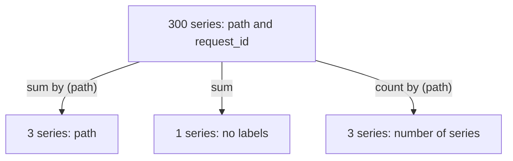

# Label Matchers And Aggregation

Labels are only useful when a query can use them. A dashboard wants the requests of one path, an alert wants the failed requests of one job, and a capacity report wants the total across every instance. Two tools do this work: label matchers in a selector pick the series, and aggregation operators combine them. This chapter shows both on the `crowded` application, which has 300 series for one metric.

## Selectors and matchers

A **selector** chooses time series. The simplest selector is a metric name. You narrow it with **label matchers** in curly braces after the name. A matcher compares one label with a value. There are four operators:

| Operator | Meaning |
| --- | --- |
| `=` | The label equals the string |
| `!=` | The label does not equal the string |
| `=~` | The label matches the regular expression |
| `!~` | The label does not match the regular expression |

Start with a helper that sends a PromQL expression to the Prometheus HTTP API from the pod `shuttle`, then count the series of the counter:

<!-- astrona:playground:renew -->

```sh
query_prometheus() {
  kubectl -n starfleet exec shuttle -- python -c 'import sys,urllib.parse,urllib.request; print(urllib.request.urlopen("http://prometheus:9090/api/v1/query?" + urllib.parse.urlencode({"query": sys.argv[1]})).read().decode())' "$1"
}
```

```sh
query_prometheus 'count(lab_http_requests_total)'
```

The answer is a single series without labels and the value 300. The function `count` returns the number of series in its input, and not the sum of their values. Now select the series of one path:

```sh
query_prometheus 'count(lab_http_requests_total{path="/orders"})'
```

The value is 100. The matcher `path="/orders"` keeps only the series whose `path` label is exactly `/orders`. You can combine matchers by separating them with commas. All matchers must match. For example, `{path="/orders", request_id="r0007"}` selects one series.

## Regular expression matchers are anchored

The operators `=~` and `!~` take a regular expression in the RE2 syntax. Prometheus anchors the expression at both ends, so `path=~"/orders"` behaves like `path=~"^/orders$"`. The expression must match the whole label value and not only a part of it. To select two paths, list them with an alternation:

```sh
query_prometheus 'count(lab_http_requests_total{path=~"/orders|/cart"})'
```

The value is 200. A pattern such as `path=~"/ord"` matches nothing, because no value is exactly `/ord`. Use `.*` when you want a prefix, for example `path=~"/or.*"`. The negated forms work the same way: `path!~"/search"` returns the series of the other two paths.

## The non-empty matcher rule

Every selector must contain a metric name or at least one matcher that cannot match the empty string. The selector `{job=~".*"}` is invalid, because `.*` matches an empty value and could select every series. The selector `{job=~".+"}` is valid. This also shows how Prometheus handles absent labels: a series without the label `job` behaves as if `job` were an empty string, so `job=""` selects the series that have no `job` label.

The metric name is a label as well. `lab_http_requests_total` is a short form of `{__name__="lab_http_requests_total"}`, and you can match it with a regular expression:

```sh
query_prometheus 'count({__name__=~"lab_.*"})'
```

The answer is larger than 300, because the pattern also matches the metrics of `probe`. Selecting by name pattern is useful for exploring but is a heavy query on a large server, because it reads every metric.

## Aggregation operators

An **aggregation operator** takes many series and returns fewer. The operators `sum`, `avg`, `min`, `max`, `count` and a few more apply to every sample value at one point in time. A clause decides which labels stay. Without a clause the result has no labels. With `by (label, ...)` the result keeps only the listed labels and one series exists for each combination of their values. With `without (label, ...)` the result keeps all labels except the listed ones.

Sum the counter by path:

```sh
query_prometheus 'sum by (path) (lab_http_requests_total)'
```

The answer has three series, each with only the label `path`. Each value is 5050, the sum of the numbers 1 to 100. The labels `request_id`, `job` and `instance` are gone, because `by` kept only `path`.

Now get the same shape with the opposite clause:

```sh
query_prometheus 'sum without (request_id, instance, job) (lab_http_requests_total)'
```

The result also has one series for each path, but the label list is different in general. `without` lists what to drop. If a new label appears on the metric later, `without` keeps it, and `by` does not. Use `by` when you know which labels a result needs. Use `without` when you want to drop one label and keep the rest, for example when you remove only `instance` to merge replicas.



The diagram shows that the clause decides the shape of the result: three aggregations over the same 300 series return three series, one series and three series.

## Count series and sum values

`sum` adds sample values and `count` counts series. Both are useful, and they answer different questions. `count by (path) (lab_http_requests_total)` gives 100 for each path, which is the number of series behind the path. `sum by (path)` gives 5050, which is the total of their values. A common mistake is to use `count` when you want a total or to use `sum` when you want to know how many targets answered.

You can also combine a matcher with an aggregation. `sum(lab_http_requests_total{path=~"/orders|/cart"})` adds only the two selected paths and returns one value, 10100. The matcher filters first, and the aggregation then works on what is left.

## Aggregation does not remove cost

An aggregation answers a question with fewer series. It does not remove the input. Each of the 300 series still exists in memory, and Prometheus still has to read all of them to calculate the sum. A dashboard that runs `sum by (path)` on every refresh reads 300 series each time.

A recording rule moves that work to a fixed interval. It evaluates the aggregation once for each interval and stores the 3 resulting series. The dashboard then reads 3 series. Save this as `rules-path.yaml` to see it work:

```yaml
apiVersion: v1
kind: ConfigMap
metadata:
  name: prometheus-rules
  namespace: starfleet
data:
  rules.yaml: |
    groups:
    - name: paths
      interval: 5s
      rules:
      - record: path:lab_http_requests_total:sum
        expr: sum by (path) (lab_http_requests_total)
```

Apply it:

```sh
kubectl apply -f rules-path.yaml
```

Then check the result. Restart Prometheus so it reads the rule file, then query the recorded name:

```sh
kubectl -n starfleet rollout restart deployment/prometheus
kubectl -n starfleet rollout status deployment/prometheus
query_prometheus 'path:lab_http_requests_total:sum'
```

Wait a few seconds if the answer is empty, because Prometheus has to scrape the application and evaluate the group first. The answer has three series with the label `path` and the name `path:lab_http_requests_total:sum`. The name follows the convention `level:metric:operations`: the level `path` is the label that stays, the metric is the name without `_total`, and `sum` is the operation. The raw 300 series still exist next to it.

You now know how to select series with the four matchers, why regular expressions are anchored and how `by` and `without` shape a result. You also saw that aggregation hides labels but does not delete the series behind them. The open question is why 300 series is a problem at all, and how many series a label design creates.

## Common pitfalls

> [!WARNING]
> - **Expecting a partial regular expression match.** `=~` and `!~` match the whole value. `path=~"/ord"` selects nothing. Use `/ord.*` for a prefix.
> - **Writing a selector that can match everything.** `{job=~".*"}` is rejected. Add a metric name or use `.+`.
> - **Confusing `by` and `without`.** `by` keeps only the listed labels, `without` drops only the listed labels. A new label on the metric stays with `without` and disappears with `by`.
> - **Using `count` for a total.** `count` counts series and ignores their values. Use `sum` to add values.
> - **Thinking an aggregation reduces memory.** The input series stay. Only a recording rule reduces the work of queries, and only changing the instrumentation reduces the series.
