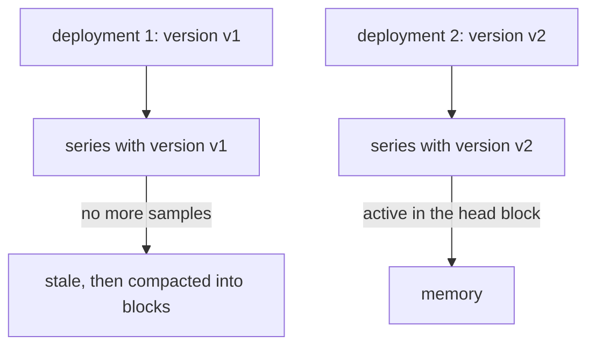

# Cardinality And Series Churn

Prometheus does not run out of disk space first. It runs out of memory, because it keeps every active series in the head block of its time series database (TSDB) in memory. The number of series is therefore the most important size of a Prometheus server. This chapter explains how a label design sets that number, how to measure it and which labels make it grow without limit.

## Cardinality is the number of series

The **cardinality** of a metric is the number of distinct label value combinations, which equals the number of series for that metric. The cardinality of a label is the number of distinct values it has. When labels are independent, the cardinality of a metric is the product of the cardinalities of its labels.

The counter `lab_http_requests_total` in the application `crowded` has two labels. The label `path` has 3 values and `request_id` has 100 values for each path. The metric has 3 times 100 equals 300 series. If you add a label `method` with 4 values and every combination occurs, the metric has 1200 series. Each label multiplies, and does not add.

A bounded label keeps the product small. The label `status` has a handful of values, and `path` has a number of values equal to the number of routes in the application. An unbounded label has a value for each user, request, session, container or timestamp. Its cardinality grows with traffic and not with the design of the application. Such a label is the most common reason for a Prometheus server that grows without control.

## Measure it

Do not guess the number. Prometheus can tell you. First define the helper that sends a PromQL expression to the HTTP API from the pod `shuttle`:

<!-- astrona:playground:renew -->

```sh
query_prometheus() {
  kubectl -n starfleet exec shuttle -- python -c 'import sys,urllib.parse,urllib.request; print(urllib.request.urlopen("http://prometheus:9090/api/v1/query?" + urllib.parse.urlencode({"query": sys.argv[1]})).read().decode())' "$1"
}
```

Count the series of one metric, then of every metric:

```sh
query_prometheus 'count(lab_http_requests_total)'
query_prometheus 'count by (__name__) ({__name__=~".+"})'
```

The first answer is 300. The second has one entry for each metric name and the number of series of that name. Look for the largest values: `lab_http_requests_total` has 300 series, more than any metric of `probe`. The second query is heavy on a large server, because it reads every series. Use it on a small server only.

The server also reports on itself. The gauge `prometheus_tsdb_head_series` holds the number of series in the head block, which is the number Prometheus keeps in memory:

```sh
query_prometheus 'prometheus_tsdb_head_series'
```

The value is the sum of all series of all targets, including the 300 of `crowded`, the series of `probe` and the series that Prometheus exposes about itself. The status API gives a ranking without a query:

```sh
kubectl -n starfleet exec shuttle -- wget -qO- http://prometheus:9090/api/v1/status/tsdb
```

The answer lists the metric names with the most series in `seriesCountByMetricName`, and the labels with the most distinct values in `labelValueCountByLabelName`. In this playground, look for `lab_http_requests_total` near the top of the first list and for `request_id` in the second.

Each target also reports how many samples it returned in one scrape, in the metric `scrape_samples_scraped`:

```sh
query_prometheus 'scrape_samples_scraped{job="crowded"}'
```

The value is 300 for the job `crowded`. A sudden jump of this number for one job is the first sign of a cardinality problem.

## What a series costs

Each active series needs memory for its labels, its index entries and the samples of the head block. A rough figure is a few kilobytes for each series. One thousand series are cheap. One million series need several gigabytes of memory, and queries over them take seconds. The cost also appears in the scrape size, the write-ahead log and the time to start after a restart.

A recording rule or a dashboard does not remove this cost. The cost lies in the input. You fix a cardinality problem where the labels are produced: in the instrumentation, or with relabeling that drops the label before the series is stored.

## What belongs in a label

A label is for a dimension that you will use in a selector or an aggregation. Ask three questions before you add one.

- Will anyone filter or group by it? A request identifier is read when you debug one request. Logs and traces answer that, and a metric does not.
- Is the number of values bounded and small? Ten to a few hundred values is normal. Values from user input, such as a user name, an email address, a URL with parameters or an IP address of a client, are unbounded.
- Does the sum over its values mean something? Summing a counter over `path` gives the total requests. If the sum has no meaning, the label probably belongs to a separate metric.

An **info metric** carries descriptive labels that do not change often. It has a name that ends in `_info` and the constant value 1, for example `lab_build_info{version="1.4.2", revision="abc123"}`. You join it to other metrics when you need the labels. This keeps the descriptive text off every other series.

## Series churn

Cardinality counts the series that exist now. **Series churn** counts how fast series appear and disappear. A series ends when its target stops exposing it or when a label value changes, because a new value is a new series. The old series stops receiving samples and the new series starts.

Churn comes from labels whose values change over time. A label with the name of a pod, a container identifier, a version string or a deployment hash gets a new value at each deployment. Each new value restarts every series that carries it. After ten deployments Prometheus has stored ten generations of series, although only the last one is active.



The diagram shows that a changing label value ends one series and starts another, so the old series stays only in the stored blocks and the new series uses memory.

Churn costs more than its size at one moment suggests. Every new series creates index entries and must be added to the head block, which is expensive. The old series are still searched when a query covers their time range, which makes long-range queries slower. Measure churn with the counter of series created in the head block:

```sh
query_prometheus 'rate(prometheus_tsdb_head_series_created_total[5m])'
```

A value near zero means the set of series is stable. A value that rises after each deployment means that a label changes with it.

Churn also breaks continuity. A graph of a counter with a `version` label shows one line that ends and another that begins. A rate over a range that spans the change has to be summed over the label to join them, and the label has to be dropped with `sum without (version)`.

## Design for stable series

Put values that change with every deployment, such as a version or a revision, in an info metric and not in the labels of every series. Use the name of a Deployment or a service for a label and not the name of a single pod, unless you need per-pod data. Never use a timestamp or an identifier of one request as a label.

When an application already exposes a bad label and you cannot change it, drop it at scrape time with a `metric_relabel_configs` rule using the action `labeldrop`. If you drop a label, make sure the remaining labels still identify each series. Two series that become identical after the drop cause duplicate samples, and Prometheus reports a scrape error for them.

You now know that the number of series is the product of the label cardinalities, how to read it from the server and why labels that change over time cause churn. The question that stays open is what Prometheus does with a series that stops, and how it tells a missing target from a missing series.

## Common pitfalls

> [!WARNING]
> - **Adding a label with unbounded values.** A user name, request identifier or client address creates a new series for each value. Put that data in logs or traces.
> - **Adding up cardinalities.** Labels multiply. Two labels with 100 values each give up to 10000 series, not 200.
> - **Fixing cardinality with a recording rule.** The rule reads the raw series and does not delete them. Fix the instrumentation or drop the label at scrape time.
> - **Dropping a label that makes series unique.** After `labeldrop`, two series with the same name and labels collide and cause scrape errors. Check what remains.
> - **Putting a version or pod name on every series.** The value changes with each deployment and restarts every series that carries it. Use an info metric.
