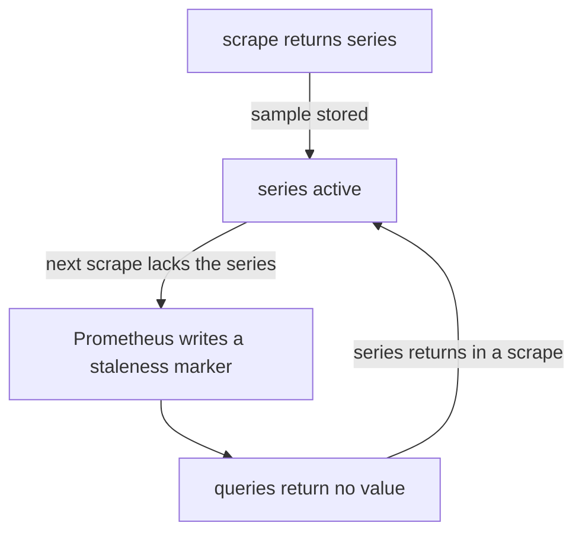

# Staleness, Up, Instance And Job

A query asks for the value of a series at one moment. Prometheus must decide what to return when the last sample is old. If the target is down, the series has ended or the application removed a label value, the old sample must not live on forever. This chapter explains how Prometheus marks a series as ended, which labels it adds to every target and how the metric `up` shows whether a scrape worked. It closes with the unit conventions that keep metric names consistent.

## The lookback window

Prometheus does not store a value for every moment. It stores samples at the scrape interval, which is two seconds in the playground. When you run an instant query at time T, Prometheus looks back from T and returns the newest sample it finds within the **lookback delta**. The default is five minutes. A series with no sample in that window returns nothing.

Without more rules, a series that ended would stay visible for five minutes after its last sample. A graph would show a value that no longer exists. Prometheus avoids this with staleness markers.

## Staleness markers

A **staleness marker** is a special sample value that Prometheus writes for a series to say that the series has ended. After the marker, a query at a later time returns no value for the series, even if the last real sample is less than five minutes old. Prometheus writes a marker in these cases:

- A scrape of a target no longer contains a series that the previous scrape contained.
- A target disappears, for example when service discovery removes it, or when the scrape fails. In the failure case all series of the target become stale.
- A recording rule stops returning a series that its previous evaluation returned.

A marker is not a zero. A zero is a real value that you can graph and add up. A stale series has no value, and a graph shows a gap. This is the reason `absent(metric)` and `up == 0` exist: a missing series does not return 0 for an alert to catch.



The diagram shows the life of a series: a marker ends it when a scrape lacks it, and a new sample brings it back.

## Watch staleness happen

The helper below sends a PromQL expression to the HTTP API from the pod `shuttle`:

<!-- astrona:playground:renew -->

```sh
query_prometheus() {
  kubectl -n starfleet exec shuttle -- python -c 'import sys,urllib.parse,urllib.request; print(urllib.request.urlopen("http://prometheus:9090/api/v1/query?" + urllib.parse.urlencode({"query": sys.argv[1]})).read().decode())' "$1"
}
```

Check that the series of `crowded` are present:

```sh
query_prometheus 'count(lab_http_requests_total)'
```

The value is 300. Now stop the application by scaling its Deployment to zero pods, wait a few scrape intervals and query again:

```sh
kubectl -n starfleet scale deployment/crowded --replicas=0
query_prometheus 'count(lab_http_requests_total)'
```

After a few seconds the answer has no result at all. The last samples are only seconds old, so the five-minute lookback alone would still return them. The staleness markers that Prometheus wrote when the scrape failed make the query empty. If the answer still shows 300, run the query again after a few seconds, because Prometheus writes the markers at the first failed scrape.

Bring the application back and check that the series return:

```sh
kubectl -n starfleet scale deployment/crowded --replicas=1
```

After the pod is ready and Prometheus has scraped it, `count(lab_http_requests_total)` is 300 again. The series are the same series with the same labels, so they continue where they stopped, with a gap in between.

## Instance and job

Prometheus adds two labels to every series that it scrapes. A **target** is an endpoint that Prometheus scrapes. A **job** is a group of targets with the same purpose, defined by one `scrape_configs` entry. The label `job` holds the `job_name` of that entry. The label `instance` identifies one target in the job. By default its value is the `host:port` of the scraped address.

In the playground the jobs are `probe`, `prometheus` and `crowded`, and the instances are `probe:8080`, `localhost:9090` and `crowded:8080`. Together the labels `job` and `instance` identify the target that a series came from. This explains how two applications can expose the same metric name without collision: the label values differ.

If the application itself exposes a label named `job` or `instance`, the values clash. By default Prometheus keeps the scraped value in a label that gets the prefix `exported_`, and keeps its own value in `job` or `instance`. The setting `honor_labels: true` reverses this. Use it only for sources such as a Pushgateway, where the pushed labels are the truth.

## The up metric

After every scrape Prometheus adds a synthetic series with the name `up` for the target, labelled with `job` and `instance`. Its value is 1 when the scrape worked and 0 when it failed. This series is created by Prometheus itself, and does not come from the application. The other synthetic series are `scrape_duration_seconds`, `scrape_samples_scraped`, `scrape_samples_post_metric_relabeling` and `scrape_series_added`.

Query it:

```sh
query_prometheus 'up'
```

The answer has one series for each target, with the label `job` set to `probe`, `prometheus` or `crowded`. Each value is 1 while the targets are healthy. Because `up` exists as a normal series even when the target is down, it is the base of the standard availability alert: `up == 0` fires when a scrape fails.

Combine `up` with aggregation to answer questions such as "which jobs have a target that is down":

```sh
query_prometheus 'count by (job) (up == 0)'
```

`up == 0` is a comparison that keeps only the series whose value is 0, and `count by (job)` counts them for each job. When all targets work, the answer is empty and not 0, because no series passes the comparison. An empty result is how PromQL reports that nothing matched, and an alert rule treats it as not firing.

## Unit and naming conventions for labels and metrics

The same rules help the reader of a query. Metric names carry the unit as a suffix, in base units: `_seconds` for durations, `_bytes` for sizes, `_ratio` for a value from 0 to 1 and `_celsius` for temperature. Do not mix a millisecond metric with a second metric, because a division between them gives a result that is wrong by a factor of 1000. A metric that counts things ends in `_total`, and a timestamp in `_timestamp_seconds`.

Label names are lowercase with underscores, such as `status_code`. A label must not repeat what the metric name says, and the unit never goes in a label. A label value is a single fact, such as `200`, and not a list or a sentence.

Recording rule names use colons. The form is `level:metric:operations`, for example `path:lab_http_requests_total:sum`. The colon marks a series that a rule produced, so no one confuses it with an instrumented metric.

You now know how Prometheus ends a series with a staleness marker, what the lookback window does for series that still have recent samples, which labels `job` and `instance` hold, and how `up` reports the health of each target. Together with matchers, aggregation and cardinality, this covers how series are named, selected and counted.

## Common pitfalls

> [!WARNING]
> - **Reading a gap as a zero.** A stale series returns no value. It does not return 0, so an alert on `metric == 0` never fires for a series that is gone. Use `absent` or `up`.
> - **Expecting an old series to stay for five minutes.** The lookback delta applies when no marker exists. A marker ends the series at once.
> - **Alerting on a metric of the application to detect a dead target.** If the target dies, its series disappear. Alert on `up == 0`.
> - **Assuming `instance` is a host name.** It is the address that Prometheus scrapes, with its port, unless a relabeling rule changes it.
> - **Mixing units.** A duration in milliseconds next to one in seconds gives results that are wrong by a factor of 1000. Use base units everywhere.
