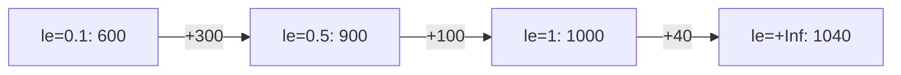

# Histograms And Summaries On The Page

A counter or a gauge is one line per label set. A histogram and a summary hold a distribution of observations, such as request durations, and the text format spreads them over several lines with fixed naming rules. A page with an incomplete histogram still parses, but the numbers that Prometheus calculates from it are wrong. This lesson shows how the lines of each type are written and what Prometheus needs from them.

## Counters and gauges in one sentence each

A counter is a value that only goes up, or resets to zero when the process restarts. Its name should end in `_total`, for example `lab_jobs_processed_total`. A gauge is a value that goes up and down, such as `lab_workers` or `lab_queue_length`. Both types use one sample line per label set, and the type word on the `# TYPE` line is `counter` or `gauge`.

The histogram and the summary need more, so the rest of this lesson covers them.

## A histogram is a family of lines

A histogram counts observations in buckets. A bucket has an upper bound, written in the label `le` (less than or equal). The bucket with `le="0.5"` counts every observation that is 0.5 or smaller. The histogram also keeps the sum of all observed values and the number of observations.

Here is the histogram that the labs use, written in the text format.

```text
# HELP lab_job_duration_seconds Job duration in seconds.
# TYPE lab_job_duration_seconds histogram
lab_job_duration_seconds_bucket{le="0.1"} 600
lab_job_duration_seconds_bucket{le="0.5"} 900
lab_job_duration_seconds_bucket{le="1"} 1000
lab_job_duration_seconds_bucket{le="+Inf"} 1040
lab_job_duration_seconds_sum 412.5
lab_job_duration_seconds_count 1040
```

The `# TYPE` line names the base name `lab_job_duration_seconds`. The sample lines add suffixes to that base name. Each suffix is a separate Prometheus metric, and each one is stored as its own series:

- `_bucket` with the label `le` holds the cumulative count for each bound.
- `_sum` holds the sum of all observed values, here 412.5 seconds.
- `_count` holds the number of observations, here 1040.

## Buckets are cumulative

The bucket values do not count separate ranges. Each bucket counts all observations up to its bound. In the example, 600 observations took 0.1 seconds or less. 900 took 0.5 seconds or less, and this includes the first 600. So 300 observations fell between 0.1 and 0.5 seconds. The numbers never decrease from one bucket to the next, because a larger bound contains everything that a smaller bound contains.



The diagram shows how each bucket adds its own observations to the count of the bucket before it. The label on each arrow is the number of observations that fall between the two bounds.

## The +Inf bucket is required

Every histogram must have a bucket with `le="+Inf"`. Its value must be identical to the value of `_count`. This is true by definition: every observation is less than or equal to positive infinity, so the last bucket holds all observations. In the example both numbers are 1040.

Prometheus does not check this rule when it parses the page. A histogram without the `+Inf` bucket is ingested without an error and `up` stays 1. The damage shows later. The function `histogram_quantile` takes the total count from the `+Inf` bucket. Without it, the function cannot compute a quantile and returns `NaN`. A dashboard then shows a gap, and no error points at the exposition page.

The buckets must also appear in increasing numeric order of the `le` values. Client libraries add the `+Inf` bucket and keep the order for you. The problem appears with hand-written pages, or with an exporter that converts data from another system.

## Quantiles from buckets

Prometheus calculates a quantile from the bucket counts with `histogram_quantile`. For the quantile 0.9 and 1040 observations, the rank is 936. The rank lies between the bucket `le="0.5"` with 900 and the bucket `le="1"` with 1000. Prometheus assumes that the observations inside a bucket are spread evenly and interpolates a value between 0.5 and 1.

The result is an estimate. Its accuracy depends on the bucket bounds that the application chose. If most observations fall inside one wide bucket, the estimate can be far from the real value. The advantage of buckets is that you can add the buckets of many instances before you calculate the quantile, so the result is correct for the whole service.

## A summary writes quantiles directly

A summary also tracks observations, but the application calculates the quantiles itself and writes them on the page. The quantile is a label with a value between 0 and 1.

```text
# HELP lab_request_seconds Request time in seconds.
# TYPE lab_request_seconds summary
lab_request_seconds{quantile="0.5"} 0.21
lab_request_seconds{quantile="0.9"} 0.48
lab_request_seconds{quantile="0.99"} 0.93
lab_request_seconds_sum 412.5
lab_request_seconds_count 1040
```

The quantile lines use the metric name without a suffix, and `_sum` and `_count` work as in a histogram. The quantiles must appear in increasing order. A summary does not need a `+Inf` bucket, because it has no buckets.

The values of a summary are exact for one process, but you cannot combine them. The 0.9 quantile of two instances cannot be averaged into the 0.9 quantile of the service. A histogram can be combined, and for this reason histograms are the usual choice when you run several instances.

## Check the histogram on the playground page

The `probe` application in the playground exposes a histogram, `lab_request_duration_seconds`. Request its page and read the bucket lines.

<!-- astrona:playground:renew -->

```sh
kubectl -n starfleet exec shuttle -- wget -qO- http://probe:8080/metrics
```

Find the lines that start with `lab_request_duration_seconds_bucket`, the line that ends with `_sum` and the line that ends with `_count`. The bucket with the largest bound must have the same value as `_count`. Now ask Prometheus for the series and for a quantile.

```sh
kubectl -n starfleet exec shuttle -- wget -qO- 'http://prometheus:9090/api/v1/query?query=lab_request_duration_seconds_count'
kubectl -n starfleet exec shuttle -- wget -qO- 'http://prometheus:9090/api/v1/query?query=histogram_quantile(0.9,lab_request_duration_seconds_bucket)'
```

The first answer holds the count of the page. The second holds a number that lies inside one of the bucket bounds. The values change with traffic, so look at the shape of the answer. If a page lacks the `+Inf` bucket, the first query still works and the second returns `NaN`.

## What you know now

You know that a histogram is written as `_bucket` lines with cumulative counts and an `le` label, plus `_sum` and `_count`. The `+Inf` bucket is required and equals the count. Prometheus accepts a page without it, but `histogram_quantile` then returns `NaN`. A summary writes quantile lines and `_sum` and `_count`, and its quantiles cannot be combined across instances. What is still open is how the response tells Prometheus which format it carries, and how you find a fault before Prometheus does.

## Common pitfalls

> [!WARNING]
> - Writing buckets as separate ranges instead of cumulative counts. The values must never decrease.
> - Leaving out the `le="+Inf"` bucket, or giving it a value that differs from `_count`.
> - Writing `le=+Inf` without quotes. Label values always need quotes.
> - Listing buckets or quantiles out of order.
> - Averaging summary quantiles from several instances. The result has no meaning.
> - Reading an estimate from `histogram_quantile` as an exact value. It depends on the bucket bounds.
