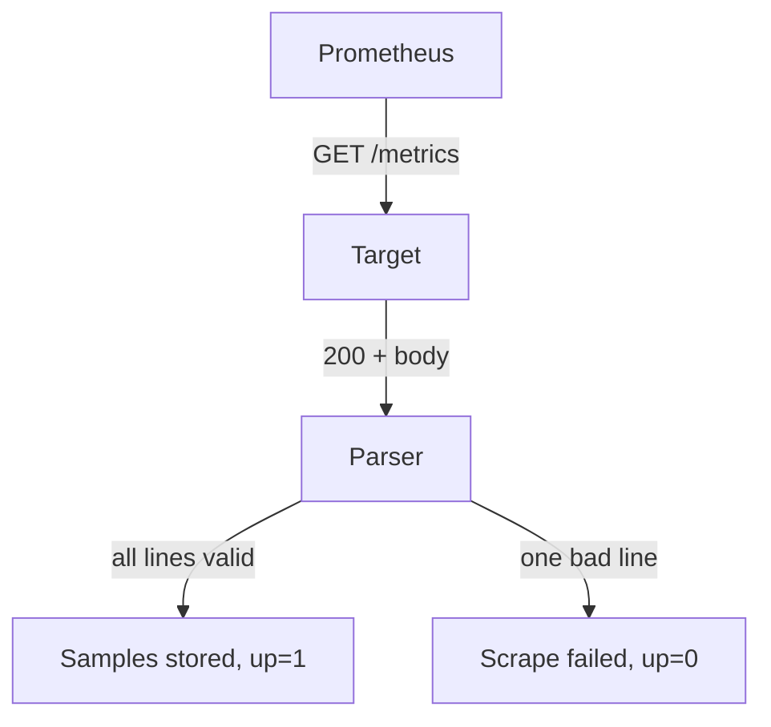

# Content Type, promtool And Parse Errors

A valid page is not enough. The HTTP response must also say what the body is, and when something is wrong you need to find the line that causes it. This lesson covers the content type header, the version of the text format, the linter `promtool check metrics` and the way Prometheus reports a failed scrape. After it you can find a fault in a page without guessing.

## The response carries the format

Prometheus sends a `GET` request to the path of the target, `/metrics` by default. The target answers with a status code, headers and the page as the body. The header `Content-Type` tells Prometheus which parser to use. For the classic text format the value is:

```text
text/plain; version=0.0.4; charset=utf-8
```

The part `version=0.0.4` is the version of the text format. The format has been stable for many years, and when the version is missing, Prometheus uses the latest text version. The target may also compress the body and set `Content-Encoding: gzip`, and the scraper asks for compression with the header `Accept-Encoding`.

Since Prometheus 3.0, a scrape target must return a valid `Content-Type` header. If the header is missing, cannot be parsed or names an unsupported format, the scrape fails. In earlier versions a missing header fell back to the text format. This matters for small custom exporters written with a plain HTTP server, because a server that sends no content type used to work and now does not.

## See the headers on the playground

The `exporter` application in the playground sets the content type in its code. Request the response with its headers. The `wget` in the `shuttle` pod can print the server response with the option `-S`, and it writes the headers to the error output, so redirect it to the screen.

<!-- astrona:playground:renew -->

```sh
kubectl -n starfleet exec shuttle -- wget -S -qO- http://exporter:8080/metrics 2>&1
```

At the top you find the status line and the header `Content-Type`. In this module the exporter answers with the classic text type, because the playground runs it in text mode. The body follows the headers.

## Why Prometheus uses the header and not the content

Prometheus does not look at the body to decide the format. It reads the content type and picks the matching parser. A page with a valid body and a wrong content type fails as surely as a page with a bad line. When you debug a scrape, always check both the headers and the body.

## Check a page with promtool

`promtool` is the command-line tool that ships with Prometheus. The subcommand `promtool check metrics` reads a metrics page from standard input and lints it. It reports problems such as a metric that does not follow the naming conventions, a counter without the suffix `_total` or a missing help text. It reads the classic text format.

The Prometheus image in the playground contains `promtool`. Send the page from the `exporter` to it. The first command fetches the page, and the second reads it. The option `-i` keeps standard input open for the pipe.

```sh
kubectl -n starfleet exec shuttle -- wget -qO- http://exporter:8080/metrics | kubectl -n starfleet exec -i deploy/prometheus -- promtool check metrics
```

The tool prints each problem it finds, one per line, and ends without output when the page has no problems. Treat the result as advice about style as well as about syntax. A page can pass the linter and still be wrong for your data, and a page with a lint warning can still be ingested. The linter is most useful in a test of a custom exporter, where you feed it the real response and fail the build on any output.

## How a scrape fails

Prometheus treats one scrape as one unit. It fetches the body, parses it and appends the samples. If the parser meets an invalid line, the scrape is marked as failed. The target is `down`, so `up` is 0, and the samples of that scrape are not stored. Old series stay in the database until they become stale.



The diagram shows that the parser decides between storing the samples and failing the scrape. The decision depends on the whole body, not on single lines.

Other faults fail the scrape before the parser runs: the target is not reachable, the connection times out, or the status code is not in the range 200 to 299. The error text differs for each case, and the next section shows where to read it.

## Read the error that Prometheus stores

Prometheus keeps the last error of each target and exposes it in the targets API. The field `lastError` holds the message, and the field `health` is `up` or `down`. Request the active targets:

```sh
kubectl -n starfleet exec shuttle -- wget -qO- 'http://prometheus:9090/api/v1/targets?state=active'
```

The answer is one JSON document with an entry for each target. Find the entry whose `labels` have `job` set to `exporter`. When the page is valid, `health` is `up` and `lastError` is an empty string. When a line is invalid, `health` is `down` and `lastError` holds the parser message, which names the position of the first invalid line. You fix the first fault, wait for the next scrape and read the message again, because a later line can hide a second fault.

The same information appears in the Prometheus user interface on the page `Status`, then `Targets`, where the error is shown next to the target.

## Two series that report every scrape

Besides `up`, Prometheus adds series that describe each scrape: `scrape_duration_seconds`, `scrape_samples_scraped` and `scrape_samples_post_metric_relabeling`. After a successful scrape, `scrape_samples_scraped` is the number of sample lines the page held. After a failed scrape, `up` is 0. These series let you alert on a broken page without reading the targets API.

Query the number of samples of the exporter:

```sh
kubectl -n starfleet exec shuttle -- wget -qO- 'http://prometheus:9090/api/v1/query?query=scrape_samples_scraped{job="exporter"}'
```

The value equals the number of sample lines on the page, because each sample line is one sample. Comment lines do not count.

## A method to repair a page

When a target is down, follow the same steps each time:

1. Read `lastError` in the targets API. It tells you if the problem is the network, the status code, the content type or a line of the body.
2. Request the page yourself from inside the cluster with `wget`, and read the line that the message names.
3. Compare the line with the rules: a valid name, quoted labels, a float value, one `# TYPE` line before the first sample.
4. Fix the source of the page. For a page that comes from a ConfigMap, apply the new ConfigMap.
5. Make sure the process serves the new content. A ConfigMap that is mounted as a volume reaches the pod after a delay. A restart of the Deployment avoids the wait.
6. Wait one scrape interval and check `up` again.

## What you know now

You know that the `Content-Type` header selects the parser and that Prometheus 3.0 and later fails a scrape when the header is missing or unsupported. You can lint a page with `promtool check metrics` and find the parser error in the field `lastError` of the targets API. One invalid line fails the whole scrape and the target shows `up` as 0. What is still open is the stricter format that Prometheus can negotiate, which adds new rules and a different ending for the page.

## Common pitfalls

> [!WARNING]
> - Checking only the body. A wrong or missing `Content-Type` also fails the scrape in Prometheus 3.0 and later.
> - Reading only the first error and stopping. After you fix a line, the next invalid line shows a new error.
> - Expecting `promtool check metrics` to accept the OpenMetrics format. It reads the classic text format.
> - Treating lint output as a parse error. A lint warning does not make Prometheus reject the page.
> - Changing a ConfigMap and checking at once. The pod can still serve the old content for up to about a minute.
