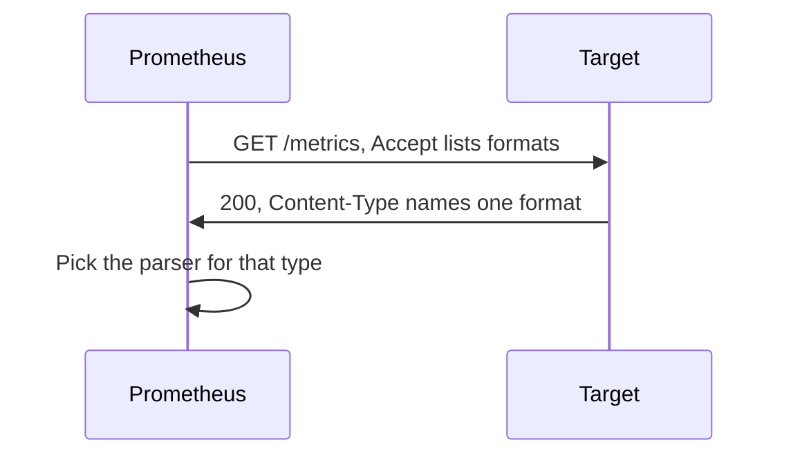

# OpenMetrics And Format Negotiation

Prometheus can read more than one exposition format, and a target can offer more than one. The scraper and the target have to agree on one format for each scrape, and the agreement happens inside the HTTP request and response. This lesson shows how the agreement works, what OpenMetrics changes compared with the classic text format, and why a page that is fine in one format fails in the other.

## Two formats, one family tree

The classic Prometheus text format, version 0.0.4, is the format of the previous module. OpenMetrics is a standard that is built on it. The text of an OpenMetrics page looks similar, but its rules are stricter and it adds features. The content type of an OpenMetrics text page is:

```text
application/openmetrics-text; version=1.0.0; charset=utf-8
```

The rest of this lesson covers how Prometheus picks a format and the rules that OpenMetrics adds.

## How the negotiation works

Each scrape request carries an `Accept` header. The header lists the content types that Prometheus can parse, in order of preference. The target reads the header and chooses one of the listed types for its response. It tells Prometheus which one it chose in the `Content-Type` header of the response. Prometheus then picks the parser that matches that content type.



The diagram shows that the target makes the choice and Prometheus follows it. A target that supports only the classic format answers with the classic type, and Prometheus still accepts it, because the classic format is also in the list.

The part of the job configuration that builds the `Accept` header is the field `scrape_protocols`. It lists protocol names in order of preference. The accepted names are `PrometheusProto`, `OpenMetricsText0.0.1`, `OpenMetricsText1.0.0`, `PrometheusText0.0.4` and `PrometheusText1.0.0`. The names are case-sensitive. The field can be set in the `global` section or in a single scrape job. If you leave it out, Prometheus uses its default list, which asks for OpenMetrics first and the classic text types after it.

## The job in the playground

In this playground the job `exporter` sets the field explicitly. Its configuration reads as follows.

```yaml
- job_name: exporter
  scrape_protocols:
  - OpenMetricsText1.0.0
  - PrometheusText0.0.4
  static_configs:
  - targets:
    - exporter:8080
```

Prometheus asks for OpenMetrics 1.0.0 first and for the classic text format as the second choice. The example application in the `exporter` Deployment reads the `Accept` header. When it finds `application/openmetrics-text`, it answers with that content type. When it does not, it answers with `text/plain; version=0.0.4`. The application only sets the header. It does not convert the page, so the page in the ConfigMap must be valid for the format that its header announces.

## Look at the negotiation

Request the page the way Prometheus does. The `wget` option `--header` sets the `Accept` header, and `-S` prints the response headers to the error output.

<!-- astrona:playground:renew -->

```sh
kubectl -n starfleet exec shuttle -- wget -S -qO- --header='Accept: application/openmetrics-text' http://exporter:8080/metrics 2>&1
```

The response header `Content-Type` names `application/openmetrics-text`. Now request the page without the `Accept` header.

```sh
kubectl -n starfleet exec shuttle -- wget -S -qO- http://exporter:8080/metrics 2>&1
```

This time the content type is the classic `text/plain` type. The body is the same in both answers. The format that the parser expects depends on the header, and not on the content.

## The # EOF line

The first rule of OpenMetrics is that a page must end with the line `# EOF`. The spec says that a partial or invalid page is erroneous in its entirety. The ending is a protection against a truncated response: if a connection breaks halfway, the last line is missing, and Prometheus knows that the page is incomplete instead of storing half of it.

```text
# TYPE lab_workers gauge
lab_workers 4
# EOF
```

A page without `# EOF` fails the scrape when the content type is OpenMetrics. A classic text page does not use the line, and a `# EOF` comment in the classic format is only a comment. Nothing may come after the line, so a blank line or another sample after `# EOF` is an error as well.

This is the reason why one page can be valid in one job and broken in another. A page for the classic format has no `# EOF`, and the same page under OpenMetrics negotiation fails with an error about the missing end of the data.

## Counters: _total and _created

OpenMetrics is strict about counters. The family is declared with its name without a suffix, and the sample of the family has the suffix `_total`.

```text
# HELP lab_jobs_failed Failed jobs by reason.
# TYPE lab_jobs_failed counter
lab_jobs_failed_total{reason="timeout"} 5
lab_jobs_failed_total{reason="oom"} 2
```

The `# TYPE` line names `lab_jobs_failed`, and the samples are `lab_jobs_failed_total`. Prometheus stores the series under the full name with the suffix, so queries use `lab_jobs_failed_total`. In the classic format, the `# TYPE` line usually names the same metric as the samples, with the suffix.

A counter may also expose a creation timestamp in a sample named `_created`. Its value is the Unix time in seconds at which the counter started. It helps Prometheus to detect a reset of the counter. The histogram and the summary also have `_created` samples. The `_created` lines are optional, and many client libraries write them in OpenMetrics mode.

## Timestamps and units

Timestamps in OpenMetrics are in seconds, not in milliseconds as in the classic format, and may have a fractional part. The specification advises against exposing timestamps on samples, because the scraper should apply its own time.

OpenMetrics also has an optional `# UNIT` line that names the unit of a family. The unit must be the suffix of the family name. For example, the family `lab_job_duration_seconds` can have `# UNIT lab_job_duration_seconds seconds`. The order of metadata lines for a family is `TYPE`, `UNIT` and then `HELP`, and each appears once.

## Types that only OpenMetrics has

OpenMetrics adds types that the classic format does not have: StateSet, Info and GaugeHistogram, plus an explicit Unknown type. Info exposes labels that do not change, such as a software version, as a metric with the suffix `_info` and a value of 1. These types are rarely asked for on their own. What you need to know is that they exist and that a classic text parser does not read them.

## What you know now

You know that Prometheus sends an `Accept` header built from `scrape_protocols`, the target chooses a format and names it in the response `Content-Type`, and Prometheus parses the body with the matching parser. A valid OpenMetrics page ends with `# EOF`, declares counters by the family name and writes the samples with `_total`. What is still open is how histograms and exemplars work in this format, and what a native histogram is.

## Common pitfalls

> [!WARNING]
> - Serving a classic page without `# EOF` while the target answers with the OpenMetrics content type. The scrape fails.
> - Writing a line or a blank line after `# EOF`.
> - Querying the counter family name instead of the series name. The series is `lab_jobs_failed_total`, not `lab_jobs_failed`.
> - Assuming that the page content selects the parser. The `Content-Type` of the response does.
> - Writing millisecond timestamps in an OpenMetrics page. The unit there is seconds.
